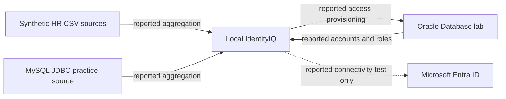

# Enterprise Identity and Access Management Engineering Lab

An independently developed IAM and identity security portfolio by **Diptesh Shahi Thakuri**, a Computer Science graduate building practical engineering experience. The primary hands-on platform is **SailPoint IdentityIQ**. This repository connects application integration, identity governance, programming and troubleshooting through a fictional organization, **Northstar Health**.

The focus is explainable implementation: how workforce data becomes an identity, how access is requested and provisioned, how failures are investigated, and how the result is verified. It does not claim production deployment or senior professional experience.

> **Evidence boundary:** the existing repository contained only a short README. Historical lab work below is **Previously Completed, Evidence Pending** until original configuration or test evidence is reviewed. New code and fixtures are explicitly illustrative; local code checks do not verify live integrations. [Status register](docs/implementation-status.md) · [Evidence ledger](docs/evidence/README.md).

## Northstar Health

Northstar Health is a fictional healthcare organization whose employees, contractors, clinicians, IT staff and partners need appropriate access throughout their relationship with the organization. Its lab requirements cover reliable HR identities, manager approvals, database access, pre-hire accounts, access changes and timely offboarding. No patient or actual employee data is used. [Business requirements](northstar-health/README.md).

## Technology and implementation status

| Area | Scope and honest status |
|---|---|
| SailPoint IdentityIQ | Reported CSV aggregation, mapping, Identity Cubes, correlation, rules and workflow experiments; evidence pending |
| Oracle Database | Reported account/entitlement aggregation, requests, approvals and RBAC; evidence pending |
| MySQL JDBC | Reported connection, five-record practice table, aggregation and mapping troubleshooting; evidence pending |
| Microsoft Entra ID connector | Reported connectivity/schema work; evidence pending. End-to-end lifecycle provisioning unverified |
| Custom conditional provisioning | In Progress: Oracle Create/Modify design, eligible identity selection and failure handling |
| Joiner lifecycle | In Progress: study/design. Pre-hire activation, complete automation and licensing remain unverified/planned |
| AD, hybrid identity and SailPoint ISC | Planned practical work; no working local AD domain or ISC tenant confirmed |
| Authentication protocols and governance | Conceptual foundation with planned hands-on exercises |

The reported local stack is macOS Apple Silicon, Tomcat 9, JDK 17 and MySQL 8, with Oracle Free in Docker. The exact IIQ build and support matrix have not been inspected. [Environment and limitations](docs/lab-environment.md).

## Current reported architecture

Every connection below is based on lab history, with evidence pending; this is not a verified end-to-end lifecycle.



[Current architecture](docs/architecture/current-lab.md) · [Target IIQ and ISC alternatives](docs/architecture/target-architecture.md) · [Aggregation, provisioning and federation diagrams](docs/architecture/engineering-flows.md).

## Reported hands-on projects

| Project | Engineering focus |
|---|---|
| [Authoritative HR CSV](sailpoint-identityiq/applications/hr-csv/README.md) and [aggregation](sailpoint-identityiq/identity-aggregation/README.md) | Schema, source attributes, account Links, identity mapping and refresh |
| [Correlation and duplicates](sailpoint-identityiq/identity-correlation/README.md) | Bob → Ann manager relationship, stable employee keys and Mitch 401 duplication |
| [Oracle integration](sailpoint-identityiq/applications/oracle/README.md) | Account versus entitlement aggregation, requests, approvals and target verification |
| [Roles and entitlements](sailpoint-identityiq/roles-and-entitlements/README.md) | Business Role → IT Role → technical entitlement, assignment versus detection |
| [MySQL JDBC](sailpoint-identityiq/applications/mysql-jdbc/README.md) | SQL source, schema/mapping and initially missing identity attributes |
| [Entra integration](sailpoint-identityiq/applications/entra-id/README.md) | Connector connectivity, employeeId matching and future pre-hire provisioning |
| [Java/BeanShell rules](sailpoint-identityiq/rules/README.md) | Identity queries, null handling, filtered selection, Link inspection and logging |

These are documented historical exercises, **not independently verified completed integrations**. Each module separates expected behavior from actual evidence and includes prerequisites, verification, troubleshooting, security and limitations.

## Work in progress and technical examples

- [Conditional Oracle provisioning](sailpoint-identityiq/workflows/conditional-oracle-provisioning/README.md): list eligible identities even without accounts; validate zero/one/multiple Links; choose Create or Modify only after policy and target-state checks. Same-plan Create then Modify ordering is not assumed.
- [Provisioning anatomy and XML illustration](sailpoint-identityiq/provisioning/README.md): plans, AccountRequests, AttributeRequests and execution/readback boundaries.
- [Standalone Java username exercise](scripts/java/README.md): typed collections, input validation and collision modeling. New illustrative code, with local tests; no target reservation or concurrency guarantee.
- [Synthetic HR fixtures](sample-data/synthetic/README.md), [MySQL setup SQL](scripts/sql/mysql-employees.sql) and [Oracle read-only verification SQL](scripts/sql/oracle-verification.sql).
- [Joiner, mover and leaver implementation plan](northstar-health/lifecycle-plan.md), [access-request flow](northstar-health/access-request.md) and [20 acceptance scenarios](northstar-health/test-scenarios.md).

## Platform expansion and IAM foundations

| Module | Initial foundation and future practical work |
|---|---|
| [SailPoint ISC](sailpoint-isc/README.md) | Sources, identity profiles, transforms, access profiles, roles, lifecycle, governance and APIs; tenant access must be established |
| [Active Directory](active-directory/README.md) | AD DS, DNS, users/groups, LDAP/Kerberos, delegation, GPO and PowerShell exercises |
| [Microsoft Entra ID](microsoft-entra-id/README.md) | App registrations/service principals, SSO, Graph, Conditional Access, governance, PIM and hybrid identity |
| [IAM concepts](iam-fundamentals/README.md), [glossary](iam-fundamentals/glossary.md) and [protocols](iam-fundamentals/protocols.md) | Authentication/authorization, IAM/IGA, RBAC/ABAC, SAML/OIDC/OAuth, SCIM, MFA, PAM and Zero Trust |
| [Identity governance](identity-governance/README.md) | Requests, reviews, certifications, SoD, least privilege, evidence and carefully scoped compliance context |

## Repository navigation

```text
docs/                    Status, evidence, environment, architecture and roadmap
sailpoint-identityiq/     Existing lab history, rules, integration and workflow design
sailpoint-isc/            Conceptual alternative and access-gated exercise roadmap
active-directory/        Planned AD and hybrid lab
microsoft-entra-id/       Cloud identity learning and implementation roadmap
iam-fundamentals/         Concepts, glossary and protocol guide
identity-governance/      Governance controls and evidence requirements
northstar-health/        Fictional business requirements, lifecycle and tests
sample-data/synthetic/   Clearly authored fictional fixtures
scripts/                 Canonical standalone Java, SQL and repository checks
learning/                Experiments, authoritative resources and interview preparation
```

Platform-specific `.bsh` source lives beside its rule documentation. Shared standalone source lives in `scripts/`; other modules link to it rather than duplicate it. There are no placeholder directories for unimplemented features.

## Getting started

1. Read the [implementation status](docs/implementation-status.md), [reported environment](docs/lab-environment.md) and [security policy](SECURITY.md).
2. Follow the [IIQ baseline checklist](sailpoint-identityiq/setup/README.md). Use only a licensed, isolated installation; this repository does not distribute IIQ or create infrastructure.
3. Start with target-read HR aggregation and correlation verification, reviewing task options because these operations update IIQ and may launch configured actions. Keep the secondary-authoritative fixture isolated because it deliberately repeats employee ID 401.
4. Run repository checks locally:

   ```sh
   python3 scripts/python/validate_repository.py
   git diff --check
   ```

5. Follow the [Java exercise](scripts/java/README.md) for the independent programming example. Do not import scripts/XML or run SQL against a connected system without inspecting its documented scope and prerequisites.
6. Add original sanitized evidence using the [lab template](docs/lab-template.md), then update the status register only for the verified scope.

## Roadmap and maintenance

Recover original evidence → complete conditional Oracle provisioning → implement one joiner → validate Entra pre-hire activation → add mover/leaver → build AD/hybrid → explore ISC as an alternative → deepen authentication and governance labs. [Detailed roadmap](docs/learning-roadmap.md) · [Troubleshooting](docs/troubleshooting.md) · [Resources](learning/resources.md) · [Contribution conventions](CONTRIBUTING.md) · [Quality record](docs/quality-assurance.md).

Recommended future GitHub name: `enterprise-identity-security-lab`. The current URL remains unchanged; [inspection and rename implications](docs/repository-migration.md) explain the decision and remaining steps.

## Security and lab limitations

Educational, synthetic and independently developed. No production experience, compliance certification or verified integration is implied by an architecture diagram. No proprietary SailPoint binaries, licensed libraries, passwords or private tenant exports belong here. The MIT license covers original repository material only; vendor products retain their own licenses. Read [SECURITY.md](SECURITY.md) before contributing or publishing evidence.
