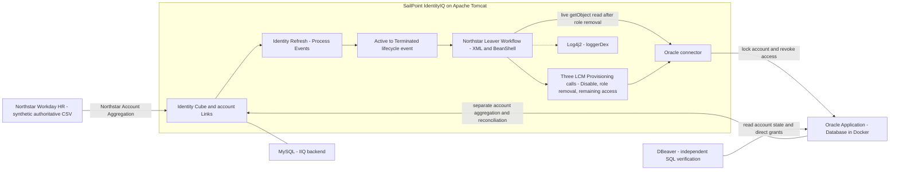

# Enterprise Identity and Access Management Engineering Lab

An independently developed IAM and identity security portfolio by **Diptesh Shahi Thakuri**, a Computer Science graduate building practical engineering experience. The primary hands-on platform is **SailPoint IdentityIQ**. This repository connects application integration, identity governance, programming and troubleshooting through a fictional organization, **Northstar Health**.

The project demonstrates authoritative HR integration, Joiner and Leaver automation, role-based and direct entitlement provisioning, Java/BeanShell scripting, XML workflow development, Oracle integration, connector APIs, access reconciliation and IAM troubleshooting. Northstar Health is a hands-on enterprise simulation, not professional employment experience or a production healthcare deployment.

> **Evidence boundary:** November 26 lifecycle results below are the owner's reported implementation/testing outcomes. Original Leaver XML, screenshots, logs and DBeaver exports were not supplied; added Leaver source is clearly labeled **reconstructed and unexecuted**. Earlier captured Oracle Create/Modify results remain separately **Verified**. [November 26 provenance](docs/evidence/leaver-2026-11-26.md) · [Captured Oracle evidence](docs/evidence/oracle-create-modify-2026-11-20.md) · [Status register](docs/implementation-status.md).

## Identity lifecycle status

| Lifecycle | Status |
|---|---|
| [Joiner](labs/joiner/README.md) | Implemented and tested |
| Mover | Planned |
| [Leaver](labs/leaver/README.md) | Implemented, with primary provisioning scenarios tested |

These are the current owner-reported lifecycle statuses. Detailed source/evidence limits remain explicit in each lab; the final no-Oracle-account Leaver path has not been separately retested after final workflow changes. Broader pre-hire, Entra and licensing work remains planned.

## Latest lab: automated Northstar Health offboarding

**Implementation and primary testing completed November 26, 2026.** An `Active` → `Terminated` change in the synthetic **Northstar Workday HR** CSV, followed by Northstar Account Aggregation and Identity Refresh with Process Events, launches **Northstar Leaver Workflow** (`IdentityLifecycle`). Twelve conditional steps discover accounts/access and use three LCM Provisioning calls to lock Oracle accounts, remove assigned Business Roles and revoke remaining Oracle roles/system privileges.

Reported primary tests cover Alex Jones's account locking, Sarah Miller's role-based deprovisioning and reconciliation, and John Doe's direct entitlement removal. The workflow skips Oracle disabling when no Oracle Link exists and continues Business Role cleanup. A live connector read after role removal avoids relying on stale stored entitlement snapshots. John's zero direct-grant rows do not establish removal of PUBLIC grants, object privileges or existing sessions.

[Leaver guide](labs/leaver/README.md) · [Conditional workflow diagram](labs/leaver/workflow-design.md) · [BeanShell/XML implementation](labs/leaver/implementation.md) · [Four-scenario test matrix](labs/leaver/test-scenarios.md) · [Failure/recovery case studies](labs/leaver/troubleshooting.md) · [Known limitations](labs/leaver/future-enhancements.md).

## Engineering objectives

- Automate identity lifecycle management from authoritative HR facts to connected application accounts.
- Provision and deprovision accounts using role-based and direct entitlement requests.
- Govern employee access throughout employment and maintain least privilege.
- Reconcile IdentityIQ's stored access information with actual target access.
- Investigate provisioning failures, partial changes and operational discrepancies using independent target verification.

## Northstar Health

Northstar Health is a fictional healthcare organization whose employees, contractors, clinicians, IT staff and partners need appropriate access throughout their relationship with the organization. Its lab requirements cover reliable HR identities, manager approvals, database access, pre-hire accounts, access changes and timely offboarding. No patient or actual employee data is used. [Business requirements](northstar-health/README.md).

## Technology and implementation status

| Area | Scope and honest status |
|---|---|
| SailPoint IdentityIQ | Reported CSV aggregation, mapping, Identity Cubes, correlation, rules and workflow experiments; evidence pending |
| Oracle Database | Scoped Create/Modify tests have captured evidence; later Leaver locking and role/direct entitlement removal tested as reported |
| MySQL JDBC | Reported connection, five-record practice table, aggregation and mapping troubleshooting; evidence pending |
| Microsoft Entra ID connector | Reported connectivity/schema work; evidence pending. End-to-end lifecycle provisioning unverified |
| Custom Oracle provisioning | Later Create-with-roles success reported for John Doe after Jane Doe's partial failure; original revised source and broader form regression unavailable |
| Joiner lifecycle | Implemented and tested as reported; earlier source/practice retained. Pre-hire/Entra/licensing coverage remains unverified/planned |
| Leaver lifecycle | Implemented; primary locking, role-based removal and direct-grant removal scenarios tested as reported |
| Mover lifecycle | Planned |
| AD, hybrid identity and SailPoint ISC | Planned practical work; no working local AD domain or ISC tenant confirmed |
| Authentication protocols and governance | Conceptual foundation with planned hands-on exercises |

The reported local stack is macOS Apple Silicon, Tomcat 9, JDK 17 and MySQL 8, with Oracle Free in Docker. Earlier scoped testing inspected IIQ 8.3; the exact November 26 configuration and vendor-supported combination were not newly validated. [Environment and limitations](docs/lab-environment.md).

## Current lab architecture

The diagram shows the current reported lifecycle design, not a captured execution trace. MySQL persistence and the Oracle target have different roles. Northstar Workday HR is simulated by CSV, with no real Workday API or patient data.



[Current architecture](docs/architecture/current-lab.md) · [Target IIQ and ISC alternatives](docs/architecture/target-architecture.md) · [Aggregation, provisioning and federation diagrams](docs/architecture/engineering-flows.md).

## Verified scoped runtime exercise

[Oracle Create and Modify lab](sailpoint-identityiq/workflows/conditional-oracle-provisioning/lab-2026-11-20/README.md): created one synthetic account and added a SELECT-only probe-table role to a separate pre-existing account through installed LCM workflows. Requests `0000000014` and `0000000013` reached `Completed/Success`; Oracle and each exactly owned Link show the intended role. Sequential duplicate guards refused repeated writes.

The evidence preserves a first Create no-op and no-email workflow warnings. The new account lacks `CREATE SESSION`, so usable sign-in is not verified. Synthetic identities/manual account binding do not establish automatic correlation; the existing custom form remains In Progress. [Actual captures and limits](docs/evidence/oracle-create-modify-2026-11-20.md).

## Reported hands-on projects

| Project | Engineering focus |
|---|---|
| [Authoritative HR CSV](sailpoint-identityiq/applications/hr-csv/README.md) and [aggregation](sailpoint-identityiq/identity-aggregation/README.md) | Schema, source attributes, account Links, identity mapping and refresh |
| [Correlation and duplicates](sailpoint-identityiq/identity-correlation/README.md) | Bob → Ann manager relationship, stable employee keys and Mitch 401 duplication |
| [Oracle integration](sailpoint-identityiq/applications/oracle/README.md) | Account versus entitlement aggregation, requests, approvals and target verification |
| [Roles and entitlements](sailpoint-identityiq/roles-and-entitlements/README.md) | Business Role → IT Role → technical entitlement, assignment versus detection |
| [MySQL JDBC](sailpoint-identityiq/applications/mysql-jdbc/README.md) | SQL source, schema/mapping and initially missing identity attributes |
| [Entra integration](sailpoint-identityiq/applications/entra-id/README.md) | Connector connectivity, employeeId matching and future pre-hire provisioning |
| [Java/BeanShell rules](sailpoint-identityiq/rules/README.md) | Identity queries, null handling, filtered selection, Link inspection and logging |

These historical modules retain their original evidence boundaries; later scoped runtime evidence and November 26 owner-reported outcomes are linked separately. Each module separates expected behavior from actual evidence and includes prerequisites, verification, troubleshooting, security and limitations.

## Work in progress and technical examples

- [Conditional Oracle provisioning](sailpoint-identityiq/workflows/conditional-oracle-provisioning/README.md): list eligible identities even without accounts; validate zero/one/multiple Links; choose Create or Modify only after policy and target-state checks. Same-plan Create then Modify ordering is not assumed.
- [Provisioning anatomy and XML illustration](sailpoint-identityiq/provisioning/README.md): plans, AccountRequests, AttributeRequests and execution/readback boundaries.
- [Standalone Java username exercise](scripts/java/README.md): typed collections, input validation and collision modeling. New illustrative code, with local tests; no target reservation or concurrency guarantee.
- [Synthetic HR fixtures](sample-data/synthetic/README.md), [MySQL setup SQL](scripts/sql/mysql-employees.sql) and [Oracle read-only verification SQL](scripts/sql/oracle-verification.sql).
- [Joiner index](labs/joiner/README.md), [lifecycle status and broader design](northstar-health/lifecycle-plan.md), [access-request flow](northstar-health/access-request.md) and [20 broader acceptance scenarios](northstar-health/test-scenarios.md).
- [Leaver reconstructed source](labs/leaver/implementation.md), [read-only offboarding verification SQL](scripts/sql/verify-oracle-offboarding.sql) and [technical concepts](docs/technical-concepts.md).

## Platform expansion and IAM foundations

| Module | Initial foundation and future practical work |
|---|---|
| [SailPoint ISC](sailpoint-isc/README.md) | Sources, identity profiles, transforms, access profiles, roles, lifecycle, governance and APIs; tenant access must be established |
| [Active Directory](active-directory/README.md) | AD DS, DNS, users/groups, LDAP/Kerberos, delegation, GPO and PowerShell exercises |
| [Microsoft Entra ID](microsoft-entra-id/README.md) | App registrations/service principals, SSO, Graph, Conditional Access, governance, PIM and hybrid identity |
| [IAM concepts](iam-fundamentals/README.md), [glossary](iam-fundamentals/glossary.md) and [protocols](iam-fundamentals/protocols.md) | Authentication/authorization, IAM/IGA, RBAC/ABAC, SAML/OIDC/OAuth, SCIM, MFA, PAM and Zero Trust |
| [Identity governance](identity-governance/README.md) | Requests, reviews, certifications, SoD, least privilege, evidence and carefully scoped compliance context |

## Repository navigation

```text
docs/                    Status, evidence, environment, architecture and roadmap
labs/joiner/             Current Joiner status and links to preserved prior work
labs/leaver/             Leaver design, implementation, tests, troubleshooting and limits
workflows/leaver/        Clearly labeled reconstructed workflow XML
sailpoint-identityiq/     Existing lab history, rules, integration and workflow design
sailpoint-isc/            Conceptual alternative and access-gated exercise roadmap
active-directory/        Planned AD and hybrid lab
microsoft-entra-id/       Cloud identity learning and implementation roadmap
iam-fundamentals/         Concepts, glossary and protocol guide
identity-governance/      Governance controls and evidence requirements
northstar-health/        Fictional business requirements, lifecycle and tests
sample-data/synthetic/   Clearly authored fictional fixtures
scripts/                 Canonical standalone Java, SQL and repository checks
learning/                Experiments, authoritative resources and interview preparation
```

Earlier platform-specific `.bsh` files remain beside their documentation. New reconstructed Leaver scripts live in `scripts/beanshell/leaver/`; the generated XML embeds those canonical files. Shared Java/SQL/Python lives in `scripts/`. There are no empty evidence directories or fabricated screenshots/logs.

## Getting started

1. Read the [implementation status](docs/implementation-status.md), [reported environment](docs/lab-environment.md) and [security policy](SECURITY.md).
2. Follow the [IIQ baseline checklist](sailpoint-identityiq/setup/README.md). Use only a licensed, isolated installation; this repository does not distribute IIQ or create infrastructure.
3. Start with target-read HR aggregation and correlation verification, reviewing task options because these operations update IIQ and may launch configured actions. Keep the secondary-authoritative fixture isolated because it deliberately repeats employee ID 401.
4. Run repository checks locally:

   ```sh
   python3 scripts/python/validate_repository.py
   python3 scripts/python/build_leaver_workflow.py --check
   git diff --check
   ```

5. Follow the [Java exercise](scripts/java/README.md) for the independent programming example. Do not import scripts/XML or run SQL against a connected system without inspecting its documented scope and prerequisites.
6. Add original sanitized evidence using the [lab template](docs/lab-template.md), then update the status register only for the verified scope.

## Roadmap and maintenance

Next: retest the final no-Oracle-account Leaver path and collect original sanitized evidence → add provisioning result validation, exception/recovery handling and automated reconciliation → implement Mover → extend to AD/Entra and broader governance. [Detailed roadmap](docs/learning-roadmap.md) · [Leaver enhancements](labs/leaver/future-enhancements.md) · [Troubleshooting](docs/troubleshooting.md) · [Resources](learning/resources.md) · [Contribution conventions](CONTRIBUTING.md) · [Quality record](docs/quality-assurance.md).

The existing repository remains `enterprise-iam-lifecycle-lab`. A [historical naming proposal](docs/repository-migration.md) is retained for context; no rename or new repository is part of this update.

## Security and lab limitations

Educational, synthetic and independently developed. No production experience, compliance certification or verified integration is implied by an architecture diagram. No proprietary SailPoint binaries, licensed libraries, passwords or private tenant exports belong here. The MIT license covers original repository material only; vendor products retain their own licenses. Read [SECURITY.md](SECURITY.md) before contributing or publishing evidence.
