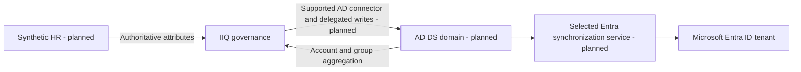

# Active Directory lab roadmap

**Status: Planned.** The author's reported internship exposure to AD SSO is separate from this lab. No Windows Server domain controller, AD domain, PowerShell execution, or IIQ-to-AD integration has been verified here.

## Objective and business requirement

Build an isolated Northstar Health directory lab that can provision a synthetic employee, manage group access, disable the employee, and reconcile the result. AD Domain Services stores directory objects and supports authentication and access control within a domain environment. Microsoft Entra ID is a separate cloud identity service; the services have different administration and protocol models. [Microsoft AD DS overview](https://learn.microsoft.com/en-us/windows-server/identity/ad-ds/active-directory-domain-services)

## Prerequisites and boundaries

- An authorized Windows Server lab and compatible compute infrastructure; choose a supported OS/hypervisor arrangement for Apple Silicon rather than assuming an x86 Windows Server VM will work locally.
- An isolated network, working DNS/time synchronization, backup/recovery plan, and no connectivity to an employer's production forest.
- Licensed/evaluation software obtained from Microsoft, a Windows management host, and the ActiveDirectory PowerShell module where supported.
- An owned DNS namespace or a deliberately isolated test namespace; no invented production domain or public DNS records.
- Dedicated delegated provisioning credentials and TLS certificate validation. Do not use a Domain Admin account for routine connector provisioning.

## Architecture and ownership

HR owns workforce facts. IIQ decides governed access and provisions through a configured connector. AD owns the on-premises objects for this design; the chosen Microsoft sync service carries scoped data to Entra ID. Entra authentication policies and cloud app access remain separate controls. An existing IIQ Entra connector test does not establish this AD path.

Select Connect Sync or Cloud Sync using the current feature and topology comparison. Do not configure both to write the same objects without an explicitly supported design. Cloud Sync capabilities are evolving; this roadmap does not assume old feature gaps remain true. [Microsoft synchronization tools](https://learn.microsoft.com/en-us/entra/identity/hybrid/sync-tools), [current comparison](https://learn.microsoft.com/en-us/entra/identity/hybrid/cloud-sync/connect-to-cloud-sync-decision-guide)

## Foundation exercises

| Stage | Concepts to implement and explain | Evidence required |
|---|---|---|
| Directory structure | Forest, tree, domain, DC, schema, global catalog, OU | Topology diagram and synthetic object inventory |
| Network dependencies | DNS service discovery, time, replication, sites | Successful DNS diagnostics, time check, replication health for multi-DC work |
| Object administration | Users, computers, security/distribution groups, group scopes | Membership report and explanation of chosen scope/nesting |
| Authentication | Kerberos ticket flow; NTLM legacy/fallback behavior; LDAP bind | Sanitized authentication observation; identify actual protocol rather than assuming Kerberos |
| Policy | Group Policy, password/account-lockout controls | Effective policy evidence for a test user and recovery procedure |
| Administration | Delegation, trusts, service accounts, group managed service accounts | Permission boundary test; prerequisite and key-management review for gMSA |
| Transport | LDAP/LDAPS certificate trust and supported connector binding | Positive TLS test plus an intentionally untrusted-certificate failure |
| Integration | IIQ aggregation, correlation, Create/Modify/Disable, group changes | Request/target/reaggregation comparison, including failed operations |

AD DS replication, trust design, Group Policy, and credential security each require dedicated validation; one successful logon does not demonstrate all of them. Use the concept links in the [official AD DS documentation](https://learn.microsoft.com/en-us/windows-server/identity/ad-ds/active-directory-domain-services).

## PowerShell exercise backlog

The cmdlets below identify **planned exercises**, not tested scripts. Confirm module availability, exact parameters, delegated rights, and scope from the installed module help. Use `-WhatIf` where supported, explicit OU/search scope, and a disposable test identity before writes.

| Exercise | Candidate cmdlets | Acceptance condition |
|---|---|---|
| Create a user | `New-ADUser`, `Get-ADUser` | Created in test OU with correct employee ID; initial disabled state verified |
| Update attributes | `Set-ADUser` | Only intended attributes changed; null values handled deliberately |
| Create a group | `New-ADGroup`, `Get-ADGroup` | Name, category, scope, and owner reviewed |
| Change membership | `Add-ADGroupMember`, `Remove-ADGroupMember` | Direct membership matches approval; nested effective access reviewed separately |
| Review membership | `Get-ADPrincipalGroupMembership`, `Get-ADGroupMember` | Direct and nested scope explicitly documented |
| Find inactivity | `Search-ADAccount` | Candidate report reviewed; replication and logon-timestamp limitations explained |
| Export evidence | `Get-ADUser`, `Export-Csv` | Synthetic identifiers only, UTF-8 output, no credentials |
| Offboard | `Disable-ADAccount`, membership operations | Login failure and entitlement removal verified; disabling alone does not prove session termination |
| Automate onboarding/offboarding | Validated functions with structured error handling | Idempotency, partial failure, retry, approval, rollback and audit tests |

Use the [Microsoft ActiveDirectory module reference](https://learn.microsoft.com/en-us/powershell/module/activedirectory/) for supported cmdlet syntax. Do not run these exercises against a production domain.

## Expected behavior, actual results, and next step

**Expected:** one synthetic HR identity correlates to one intended AD account; approved groups are granted and removed with recorded outcomes. Duplicate HR IDs, ambiguous accounts, unreachable DCs, and expired certificates stop the operation or produce a visible exception.

**Actual results:** no AD lab deployed or tested. The macOS host alone does not supply AD DS. Next establish a supported isolated Windows lab and capture a directory-read baseline before enabling SailPoint writes.
