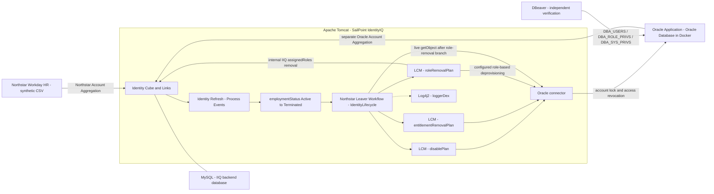
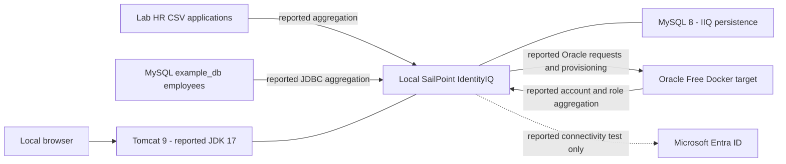

# Current lab architecture

## November 26 lifecycle implementation

Joiner is implemented/tested and Leaver has its primary provisioning scenarios tested **as reported by the owner**. Mover is planned. The diagram represents the current reported design, not a captured runtime trace. [Leaver documentation](../../labs/leaver/README.md), [conditional step graph](../../labs/leaver/workflow-design.md) and [E-005 evidence limits](../evidence/leaver-2026-11-26.md).

The three LCM paths are conditional, as shown in the detailed step graph; this architecture diagram groups responsibilities. MySQL persistence is not the Oracle provisioning target. The earlier MySQL JDBC practice application below is another logical source. Log4j2 configuration, task/event/application exports and the original Leaver XML were not supplied; example source does not provision this environment. Retrieving a ResourceObject does not itself reconcile stored Links.

## Preserved November 20 reported baseline

**Historical status: Previously Completed, Evidence Pending.** The following diagram reflects E-002, before the separately captured E-004 exercise and later owner-reported E-005 lifecycle update. It preserves the earlier connections and their original evidence boundary.

Solid edges still represent **reported history with evidence pending**, not newly verified work. The Entra edge specifically does not claim account creation, group assignment, activation or licensing. HR sources include ACMEE HR, Practice CSV, NorthStar HR CSV, Friends CSV and Northstar Workday HR simulated by CSV; none is a real Workday integration.

The MySQL JDBC practice source and IIQ persistence are separate logical responsibilities even if hosted on the same machine. Oracle was a local Docker adaptation of instructional material, not a production Oracle deployment. AD and ISC are absent from this current-state diagram because their local implementations have not been confirmed.

See [environment](../lab-environment.md), [status](../implementation-status.md), [aggregation](../../sailpoint-identityiq/identity-aggregation/README.md), [Oracle](../../sailpoint-identityiq/applications/oracle/README.md), [MySQL](../../sailpoint-identityiq/applications/mysql-jdbc/README.md) and [Entra](../../sailpoint-identityiq/applications/entra-id/README.md).
