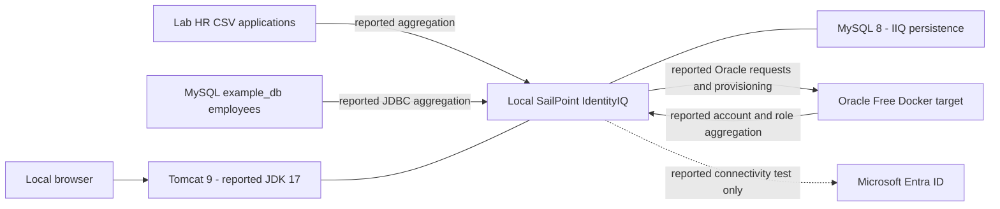

# Current reported lab architecture

**Status: Previously Completed, Evidence Pending.** This diagram reflects E-002, the owner's lab history. These are independently exercised lab connections, not a verified continuous lifecycle. No deployed configuration was inspected; no runtime integration is marked Verified.

Solid edges still represent **reported history with evidence pending**, not newly verified work. The Entra edge specifically does not claim account creation, group assignment, activation or licensing. HR sources include ACMEE HR, Practice CSV, NorthStar HR CSV, Friends CSV and Northstar Workday HR simulated by CSV; none is a real Workday integration.

The MySQL JDBC practice source and IIQ persistence are separate logical responsibilities even if hosted on the same machine. Oracle was a local Docker adaptation of instructional material, not a production Oracle deployment. AD and ISC are absent from this current-state diagram because their local implementations have not been confirmed.

See [environment](../lab-environment.md), [status](../implementation-status.md), [aggregation](../../sailpoint-identityiq/identity-aggregation/README.md), [Oracle](../../sailpoint-identityiq/applications/oracle/README.md), [MySQL](../../sailpoint-identityiq/applications/mysql-jdbc/README.md) and [Entra](../../sailpoint-identityiq/applications/entra-id/README.md).
