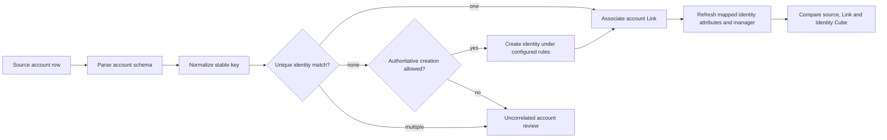
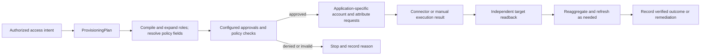
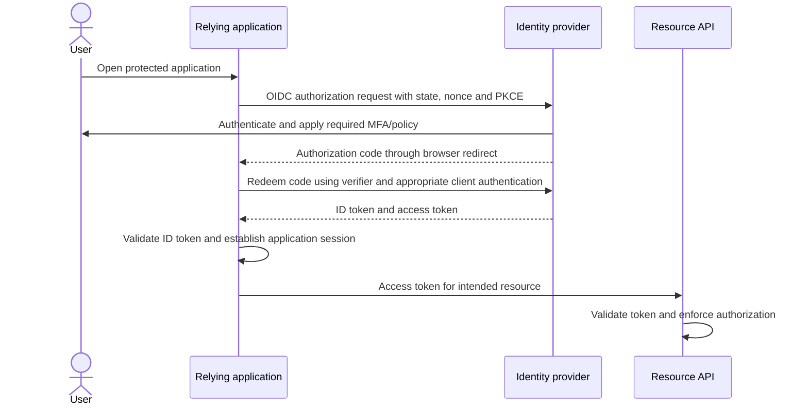

# Identity engineering flows

**Status: Conceptual.** Each flow is a model for an isolated lab; exact fields, task options and execution APIs depend on the installed products.

## Aggregation and correlation

This is a design for handling ambiguity, not a statement that all connectors automatically quarantine duplicates. Configure and test the actual correlation rules. Aggregation reads accounts; correlation associates them with a person; refresh updates selected identity/role data. SailPoint documents configurable [account aggregation](https://documentation.sailpoint.com/identityiq_84/help/tasks/account_aggregation.html) and [identity refresh](https://documentation.sailpoint.com/identityiq_84/help/tasks/identity_refresh.html) options. Avoid enabling provisioning as an incidental diagnostic step.

## ProvisioningPlan lifecycle

This summarizes the proposed standard access-request path; form/approval ordering is workflow-dependent and not universal. An AccountRequest identifies application, operation and native account identity; AttributeRequests describe intended field/entitlement operations. A plan expresses intent, not successful execution. [IIQ provisioning processing](https://documentation.sailpoint.com/identityiq/8.5/help/provisioning/process_provisioning.html) explains compilation and handlers; release 8.5 is a reference, not the unconfirmed local version. See the [conditional workflow](../../sailpoint-identityiq/workflows/README.md) for account-existence decisions.

## Authentication and federation

This is a conceptual OIDC authorization-code flow, not an implemented Entra SSO integration. The ID token is for the client; the access token is for its resource API. SAML uses assertions and a different protocol flow; SCIM provisions resources and does not authenticate interactive sessions. See the [protocol guide](../../iam-fundamentals/protocols.md) for official specifications and validation requirements.
