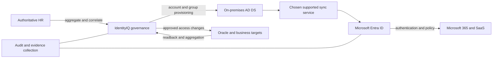
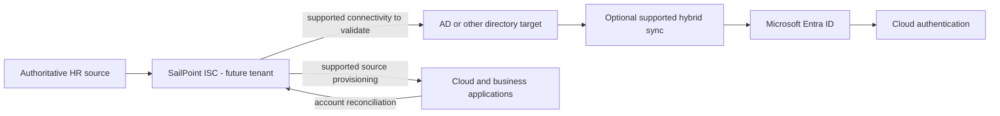

# Target architecture alternatives

**Status: Conceptual. All components and flows below require practical validation.** Choose one governance platform per architecture exercise. These diagrams do not propose running IIQ and ISC together by default.

## Alternative A — IdentityIQ with a hybrid directory

HR owns employment facts; IIQ correlates identity and governs access; AD owns the directory accounts selected for on-premises authority; a supported synchronization service carries the selected objects/attributes to Entra. Entra provides cloud identity and access functions. Synchronization is a separate boundary, not a consequence of connecting IIQ to Entra. Microsoft's [hybrid identity overview](https://learn.microsoft.com/en-us/entra/identity/hybrid/whatis-hybrid-identity) describes the provisioning/synchronization distinction.

Before implementation, choose supported Windows/sync infrastructure, scope, source anchor, matching strategy and authentication method. Do not provision independent cloud and synchronized versions of the same person without a deliberate matching/authority design. A cloud-only alternative may let IIQ provision Entra directly; that is a different topology from the synchronized path shown here. Assign one writer per managed attribute to prevent competing changes.

## Alternative B — SailPoint ISC governance

ISC sources, identity profiles, transforms, lifecycle states, access profiles and workflows have their own contracts; they are not IIQ XML workflows or BeanShell rules. Connectivity infrastructure, licenses and available operations must be checked for each source. See the [ISC roadmap](../../sailpoint-isc/README.md) before treating any box as available.

## Decisions required before execution

| Decision | Evidence needed |
|---|---|
| IIQ or ISC for a given practical lab | Accessible licensed environment and supported connector |
| Cloud-only or hybrid account authority | Attribute ownership map and supported matching/sync design |
| Source of immutable employee identity | Unique HR key, rehire policy, duplicate detection and exception handling |
| Least-privilege access model | Business owner, role/entitlement definition, approval and SoD policy |
| Lifecycle completion | Target readback, reconciliation and failure/replay evidence |
| Authentication protection | Tested MFA/session/Conditional Access policy and recovery path |

Any coexistence/migration design between IIQ and ISC would be a separate future experiment requiring governance ownership, connector scope and conflict validation.
