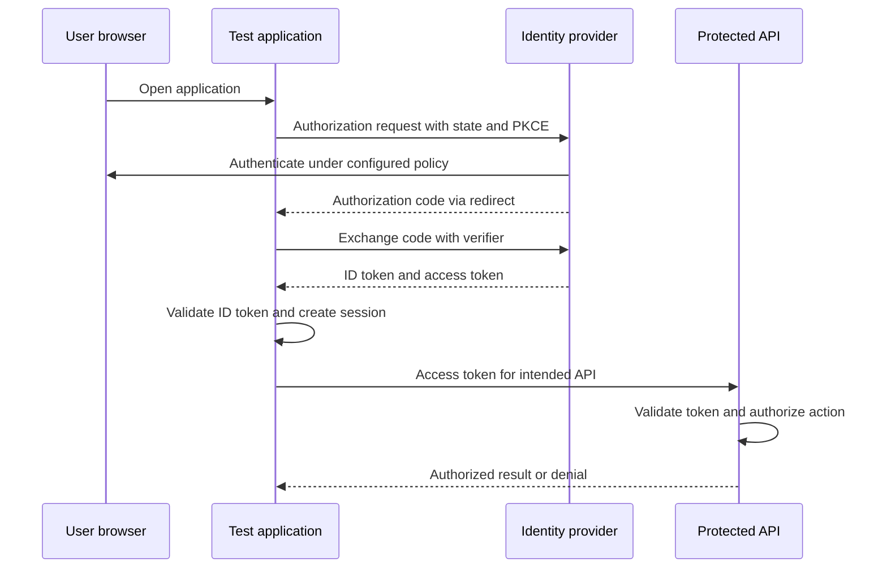

# IAM protocols and formats

**Status: Conceptual. All exercises below are Planned.** Flows and requests are illustrative; no endpoints were deployed or tested. These technologies solve different problems: JSON, XML and JWT are formats, REST is an architectural style, TLS protects transport, and federation/provisioning protocols define higher-level behavior.

## LDAP and LDAPS

**LDAP — Lightweight Directory Access Protocol.** Purpose: read and modify directory entries. Business use: aggregate AD accounts. Flow: bind → search under a base DN → process entries → unbind; for example, search a test OU for `(employeeID=105)`. Security: escape filter/DN inputs according to the applicable syntax, scope reads, validate server identity, and never send simple-bind credentials over an unprotected connection. Relationship: LDAP is a directory protocol; it does not define SAML/OIDC browser SSO. **Planned lab:** scoped read of a synthetic AD user with a delegated account. [RFC 4511](https://www.rfc-editor.org/rfc/rfc4511.html)

**LDAPS — LDAP over TLS (common deployment term).** Purpose: protect LDAP transport, often using implicit TLS; StartTLS is another TLS-establishment approach. Business use: secure connector-to-directory traffic. Flow: TLS handshake with trusted server certificate → LDAP operations. Security: check trust chain, hostname, expiry and supported binding/signing requirements; accepting any certificate defeats server authentication. Relationship: uses LDAP semantics and TLS rather than replacing either. **Planned lab:** positive certificate-trust test plus failed untrusted-certificate test. [LDAP authentication and StartTLS, RFC 4513](https://www.rfc-editor.org/rfc/rfc4513.html)

## Kerberos

**Kerberos V5 — network authentication protocol (name, not an acronym).** Purpose: ticket-based authentication. Business use: AD-integrated service access. Flow: client obtains a ticket-granting ticket from the KDC, requests a service ticket, and presents it to the service. Security: protect service credentials, maintain time/DNS/SPN correctness, and validate the actual negotiated protocol; a logon may fall back to a different mechanism. Relationship: directory data can be read using LDAP while Kerberos authenticates to a service. **Planned lab:** inspect a test user's tickets and service access without publishing ticket material. [RFC 4120](https://www.rfc-editor.org/rfc/rfc4120.html)

## SAML 2.0

**Security Assertion Markup Language.** Purpose: exchange security assertions between an IdP and SP. Business use: browser federation to a legacy enterprise app. Flow: SP request → IdP authentication → signed response/assertion to the SP assertion consumer service → application session. Security: validate signature, trusted issuer, audience, recipient, timing and request correlation; defend against replay and XML signature/parser attacks. Relationship: XML-based federation compared with OIDC's OAuth-based authentication model. **Planned lab:** one synthetic test app; validate both successful login and rejected wrong-audience response in a controlled test harness. [OASIS SAML core](https://docs.oasis-open.org/security/saml/v2.0/saml-core-2.0-os.pdf)

## OAuth 2.0

**OAuth 2.0 — authorization framework (OAuth is the protocol name).** Purpose: delegated or application API access. Business use: an approved client calls a protected API. Flow for an interactive client: authorization request with PKCE challenge → authorization code → token exchange using verifier → API call with access token. Security: exact redirect validation, scoped grants, protected tokens and current flow guidance; do not use a client secret as proof of public-client identity. Relationship: OAuth alone does not specify a user-login identity assertion. **Planned lab:** demonstrate permitted/denied scopes with an isolated API. [OAuth security BCP, RFC 9700](https://www.rfc-editor.org/rfc/rfc9700), [PKCE, RFC 7636](https://www.rfc-editor.org/rfc/rfc7636.html)

## OpenID Connect

**OIDC — OpenID Connect.** Purpose: authentication on top of OAuth 2.0. Business use: modern application SSO. Flow: code flow with `scope=openid` → token endpoint → validate ID token → establish application session. Security: apply issuer, audience, signature, expiration and flow-specific nonce checks; do not use an ID token as an API bearer token. Relationship: may issue a JWT ID token while an access token authorizes API use. **Planned lab:** compare a validated ID token with an API access token using synthetic accounts; store neither token in Git. [OIDC Core 1.0](https://openid.net/specs/openid-connect-core-1_0.html)

This is a **planned illustrative flow**. Exact client architecture determines where verifier/token handling occurs; a browser-only app must not embed a confidential-client secret.

## JWT

**JSON Web Token.** Purpose: represent claims using signed/MAC-protected or encrypted structures. Business use: an issuer conveys claims to a relying service. Example signed representation: `BASE64URL_HEADER.BASE64URL_PAYLOAD.SIGNATURE` (placeholder only). Security: enforce algorithm policy and claim validation; decoding is not verification and signing is not encryption. Relationship: OIDC uses JWT ID tokens, while OAuth access tokens may have another format. **Planned lab:** reject expired/wrong-audience test tokens without generating real tenant credentials. [RFC 7519](https://www.rfc-editor.org/rfc/rfc7519.html), [JWT BCP, RFC 8725](https://www.rfc-editor.org/rfc/rfc8725.html)

## SCIM 2.0

**System for Cross-domain Identity Management.** Purpose: standardized identity-resource provisioning. Business use: create/update/deactivate SaaS users. Example flow: authenticated `POST /Users` with a schema-compliant fictional user, followed by a read to verify the result; a supported PATCH may change `active` to false. Security: enforce API authentication/authorization, validate schemas, handle pagination/concurrency and avoid logging credentials. Relationship: SCIM provisions identities; SAML/OIDC authenticate them, and OAuth may protect the SCIM API. **Planned lab:** create, correlate, modify and deactivate one disposable user, recording target behavior. Check supported schemas and RFC updates for the implementation. [RFC 7644](https://www.rfc-editor.org/rfc/rfc7644)

## REST APIs

**REST — Representational State Transfer; API — Application Programming Interface.** Purpose: resource-oriented application interaction under architectural constraints. Business use: automate identity reporting. Example: `GET /users/ILLUSTRATIVE_ID` returns a resource representation; exact endpoint semantics are product-defined. Security: authenticate and authorize each request, constrain scopes, validate inputs, handle throttling/retries and never place secrets in URLs. Relationship: SCIM specifies particular resources/operations; arbitrary JSON over HTTP is not automatically SCIM or fully RESTful. **Planned lab:** read-only Graph or ISC request with pagination and error handling. [Fielding's REST definition](https://ics.uci.edu/~fielding/pubs/dissertation/rest_arch_style.htm), [HTTP semantics, RFC 9110](https://www.rfc-editor.org/rfc/rfc9110.html)

## JSON and XML

**JSON — JavaScript Object Notation.** Purpose: structured data interchange. Business use: Graph/SCIM payloads. Example: `{"employeeId":"105","active":false}` is illustrative data, not a guaranteed endpoint schema. Security: parse rather than evaluate as code; validate types, size and schema; redact sensitive values. Relationship: JSON is a format used by APIs and JWT claims, not an authentication protocol. **Planned lab:** validate a synthetic payload and reject a wrong-type field. [RFC 8259](https://www.rfc-editor.org/rfc/rfc8259.html)

**XML — Extensible Markup Language.** Purpose: structured tagged documents. Business use: IIQ workflow definitions and SAML messages. Example: `<employee id="105"><status>prehire</status></employee>`. Security: constrain parser features, external entities, document size and trusted inputs; XML well-formedness does not prove product-schema validity or safe execution. Relationship: SAML adds security semantics to XML; IIQ adds its own configuration model. **Planned lab:** parse an illustrative workflow without importing it; separately validate against the installed IIQ version before deployment. [W3C XML 1.0](https://www.w3.org/TR/xml/)

## X.509 and TLS

**X.509 — ITU-T public-key certificate standard designation.** Purpose: bind identities/names to public keys under a trust model. Business use: authenticate an LDAPS server. Flow: server presents certificate chain → client validates trust, names and validity under policy. Security: protect private keys, manage renewal/revocation, and avoid publishing real infrastructure certificates unnecessarily. Relationship: commonly used in TLS; a certificate alone does not encrypt every application payload. **Planned lab:** inspect a disposable certificate and document trust failure. [Internet X.509 profile, RFC 5280](https://www.rfc-editor.org/rfc/rfc5280.html)

**TLS — Transport Layer Security.** Purpose: authenticated, confidential and integrity-protected transport. Business use: HTTPS APIs and directory connections. Flow: handshake negotiates parameters and authenticates the peer as configured → protected application data. Security: validate certificates, use supported versions/configuration and protect endpoint keys; TLS does not replace application authorization. Relationship: HTTPS and LDAPS carry different application protocols over TLS. **Planned lab:** verify endpoint hostname/trust and inspect negotiated protocol in an isolated environment. [TLS 1.3, RFC 8446](https://www.rfc-editor.org/rfc/rfc8446.html)

## RADIUS

**Remote Authentication Dial In User Service.** Purpose: network access authentication and authorization exchanges. Business use: VPN or wireless access through a network access server. Flow: NAS sends Access-Request → server returns Access-Accept, Reject or Challenge. Security: protect transport and shared secrets according to current implementation guidance; legacy RADIUS is not generally equivalent to a fully encrypted TLS channel. Relationship: can carry EAP-related access decisions; it is distinct from SAML browser federation. **Planned lab:** controlled network access test with synthetic users and redacted exchanges. [RADIUS base protocol, RFC 2865](https://www.rfc-editor.org/rfc/rfc2865.html)

## WebAuthn

**Web Authentication.** Purpose: browser API for public-key credential registration/authentication. Business use: passkey sign-in. Flow: relying party issues challenge → authenticator creates or uses a credential bound to the relying party → server verifies the response. Security: validate challenge, origin, RP ID and user verification requirements; secure account recovery and enrollment. Relationship: part of FIDO2 and often used by an IdP before SAML/OIDC federation. **Planned lab:** register a test passkey, verify login and reject an incorrect challenge in a test app. [W3C WebAuthn Level 2](https://www.w3.org/TR/webauthn-2/)

## Evidence rule

For each practical exercise, record environment/version, sanitized input, expected result, actual result, negative test, cleanup and limitations. None of the descriptions above establish a successful protocol integration. Return to the [foundation distinctions](README.md) when deciding whether a failure concerns authentication, authorization, provisioning, or transport.
