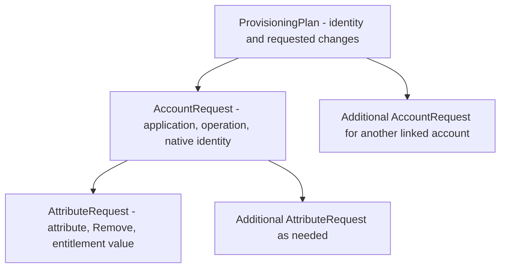
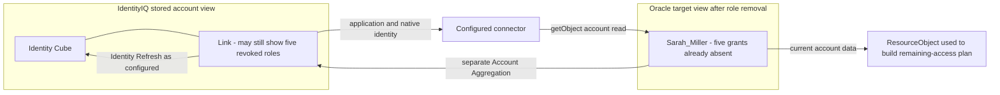

# BeanShell, connector and ProvisioningPlan implementation

**Source provenance:** original Leaver XML and scripts were unavailable in the inspected repository and supplied material. The seven `.bsh` files below and their generated XML are **reconstructed, unexecuted examples** of the owner's reported design. They are not the original lab export. The short connector/AttributeRequest fragments and two plan shapes explicitly identified below were supplied by the owner; they are not captured logs. [Evidence record](../../docs/evidence/leaver-2026-11-26.md).

## Canonical source map

| Workflow step | Canonical example | Behavior |
|---|---|---|
| Log Terminated Employee | [log-terminated-employee.bsh](../../scripts/beanshell/leaver/log-terminated-employee.bsh) | IIQ Identity read and minimal Log4j2 `loggerDex` event |
| Check Oracle Account | [check-oracle-account.bsh](../../scripts/beanshell/leaver/check-oracle-account.bsh) | IIQ Link discovery; returns Boolean |
| Discover Assigned Business Roles | [discover-business-roles.bsh](../../scripts/beanshell/leaver/discover-business-roles.bsh) | Read assigned Bundles and filter type `business` |
| Discover Oracle Entitlements | [discover-oracle-entitlements.bsh](../../scripts/beanshell/leaver/discover-oracle-entitlements.bsh) | Stored snapshots with `wfcontext.setVariable()` |
| Build Disable Provisioning Plan | [build-disable-plan.bsh](../../scripts/beanshell/leaver/build-disable-plan.bsh) | Plan construction only |
| Build Business Role Removal Plan | [build-business-role-removal-plan.bsh](../../scripts/beanshell/leaver/build-business-role-removal-plan.bsh) | Plan construction only |
| Build Oracle Entitlement Removal Plan | [build-entitlement-removal-plan.bsh](../../scripts/beanshell/leaver/build-entitlement-removal-plan.bsh) | Live connector reads plus plan construction; **contacts Oracle if executed** |

The three execution steps are XML subprocess references, not additional direct-executor scripts. The [XML builder](../../scripts/python/build_leaver_workflow.py) embeds the canonical scripts into [northstar-leaver-workflow.example.xml](../../workflows/leaver/northstar-leaver-workflow.example.xml). Maintain the `.bsh` files and regenerate rather than hand-edit two implementations.

```sh
python3 scripts/python/build_leaver_workflow.py
python3 scripts/python/build_leaver_workflow.py --check
python3 scripts/python/validate_repository.py
```

These commands operate on repository files only. They do not import, launch or execute a workflow, obtain a connector, aggregate accounts, refresh identities or modify a database.

## Identity lookup and Identity Cube

Reconstructed fragment matching the reported lookup:

```java
Identity iden = context.getObjectByName(Identity.class, identityName);
if (iden == null) throw new IllegalArgumentException("Identity was not found");
Object employmentStatus = iden.getAttribute("employmentStatus");
```

`context` is the IIQ object-access context. `Identity.class` selects the object type and `identityName` is its exact name. The resulting Identity is the object behind the **Identity Cube**, which presents person attributes, roles and linked accounts together. `employmentStatus` is a configured identity attribute mapped from the authoritative source; its spelling, case and mapping matter. The lifecycle event evaluates `Active` → `Terminated`; the reconstructed logging script records the current value and does not itself define the event.

An employee ID, IIQ object ID, display name and Identity name are different identifiers even when a lab happens to use an employee ID as the Identity name. Do not substitute the Oracle native identity into this lookup.

## Application-specific account discovery

The examples loop through `iden.getLinks()`, check `link.getApplicationName()` against **`Oracle Application`**, and obtain `link.getNativeIdentity()` for account requests. `link.getApplication()` returns the configured Application object needed to obtain a connector. Other Links, including the authoritative HR account, must not become Oracle requests.

`hasOracleAccount` means a matching Link was found. It is not an independent target existence check: Jane Doe's partial-provisioning incident demonstrates that an Oracle account can exist before its Link does. Conversely, a stored Link can outlive a target-side change. The final workflow iterates every discovered matching Link for Disable and remaining-access plans, rather than hardcoding an employee username. Multiple-account execution was not separately reported tested.

## Assigned Business Roles

`iden.getAssignedRoles()` returns assigned role `Bundle` objects in the reported discovery approach. Inspect `role.getType()` and retain **`business`**; use `role.getName()` for the internal role-removal AttributeRequest. A detected IT Role and an explicitly assigned Business Role are not interchangeable removal targets.

The reconstruction stores role names in `assignedBusinessRoles`. It models the demonstrated assignment scope; duplicate/multiple assignments requiring assignment IDs remain a future enhancement. Role-definition deletion is never performed.

## Early Oracle entitlement discovery

The discovery step reads `link.getAttribute("ROLES")` and `link.getAttribute("SYSTEM_PRIVILEGES")`. Values can be a Collection, a single value or null. The examples normalize a Collection into a new List, wrap a non-null scalar in a List, and treat null as no represented values. They retain original entitlement values rather than parsing or guessing the ADMIN_OPTION suffix.

The reconstruction groups these snapshots by native identity and sets:

```java
wfcontext.setVariable("oracleRoles", roles);
wfcontext.setVariable("oracleSystemPrivileges", privileges);
```

`wfcontext` is the workflow context. These two variables preserve early discovery context; they are **not reused as the final remaining-access source after Business Role removal**. The other builders return plans into XML `resultVariable` bindings. Setting a workflow variable and returning a step result are related data-passing mechanisms with separate bindings.

## Plan hierarchy and operations



| API / field | Responsibility in Northstar offboarding |
|---|---|
| `new ProvisioningPlan()` | Create the container for one provisioning operation. |
| `plan.setIdentity(iden)` | Associate the intended IIQ Identity with the plan. |
| `new AccountRequest()` | Describe one internal-IIQ or target account operation. |
| Application name | Route to `Oracle Application` for Oracle changes or `IIQ` for role-assignment changes. |
| Native identity | Oracle Link's account key for target changes; IIQ Identity name for the internal request. |
| `AccountRequest.Operation.Disable` | Disable the Oracle account; observed as locking in this lab. |
| `AccountRequest.Operation.Modify` | Modify assigned roles or target entitlements while retaining the account. |
| `new AttributeRequest(...)` | Specify the attribute, operation and value to change. |
| `ProvisioningPlan.Operation.Remove` | Remove an entitlement or assigned-role value, rather than replace unrelated values. |
| `acctReq.add(attrReq)` | Add an attribute-level request to the account operation. |
| `plan.add(acctReq)` | Add the account operation to the plan; does not execute it. |

No employee-specific Oracle role names are hardcoded into the remaining-entitlement builder. The application/schema names are configuration constants; role and privilege **values come from the account**.

## Account Disable plan

The builder creates a Disable AccountRequest for every Oracle Link, addressed by that Link's application/native identity. The following shape was supplied by the owner; it is a simplified sample, not a saved runtime capture:

```xml
<ProvisioningPlan>
    <AccountRequest
        application="Oracle Application"
        nativeIdentity="Alex_Jones"
        op="Disable"/>
</ProvisioningPlan>
```

In Alex's reported test Oracle changed from `OPEN` to `LOCKED`. The database user remained present. Disablement does not imply deletion, role removal, system-privilege revocation or existing-session termination. Account grants may remain on a locked database user, which is why later plan stages remove access separately.

| Operation | Result intended in this lab |
|---|---|
| Account disabling | Lock the existing Oracle user. |
| Account deletion | Remove the target user according to a separate retention/deletion policy; not implemented here. |
| Business Role removal | Remove an IIQ role assignment and invoke the configured role-based deprovisioning behavior. |
| Entitlement revocation | Remove specific remaining target role/system-privilege values. |

## Internal IIQ Business Role removal

Owner-supplied sample plan shape:

```xml
<ProvisioningPlan>
    <AccountRequest
        application="IIQ"
        nativeIdentity="NH-1001"
        op="Modify">
        <AttributeRequest
            name="assignedRoles"
            op="Remove"
            value="dba - Business"/>
    </AccountRequest>
</ProvisioningPlan>
```

The application is **`IIQ`**, because `assignedRoles` belongs to the IIQ Identity rather than the Oracle account schema. Its native identity is the **IdentityIQ Identity name**; `NH-1001` illustrates the supplied plan, not a rule that every employee ID equals an Identity name. The reconstructed builder uses `iden.getName()`.

Removing `dba - Business` removes Sarah's assignment, not the Bundle definition available for other identities. In the reported test, that Business Role required `dba - IT`, whose profile contained `ACCHK_READ`, `ADM_PARALLEL_EXECUTE_TASK`, `APPLICATION_TRACE_VIEWER`, `AQ_ADMINISTRATOR_ROLE` and `AQ_USER_ROLE`. Role-based removal revoked all five Oracle grants in this configuration, and the IT Role stopped displaying. Other assignment, retention, shared-access and role-propagation configurations can differ; this is not a universal guarantee.

## Stored Link versus live ResourceObject

After Sarah's role removal, Oracle showed all five grants revoked while IIQ initially still displayed them. Account Aggregation and Identity Refresh later reconciled the stored view. Reusing the pre-removal snapshot for a new plan could request removal of grants already gone.

The following live retrieval fragment was supplied by the owner and is preserved here:

```java
Application app = link.getApplication();

Connector connector =
    ConnectorFactory.getConnector(app, null);

ResourceObject account = connector.getObject(
    "account",
    link.getNativeIdentity(),
    null
);
```

| Object / method | Meaning |
|---|---|
| `Link` | Stored IIQ representation of a correlated application account. |
| `Application` | Configured Oracle application, schema and connector definition. |
| `ConnectorFactory.getConnector(app, null)` | Obtain the configured connector for this Application. |
| `connector.getObject("account", nativeIdentity, null)` | Retrieve that account's current connector-visible information in this lab. |
| `ResourceObject` | Account information returned by the connector; not the stored Link itself. |



A connector read does **not** itself guarantee a persisted Link or reconciled Identity Cube. It is a point-in-time connector-visible read, not a database transaction lock or an independent second verification channel. A null/missing account, insufficient schema or connector error must not be interpreted as verified absence of all access. The reconstruction propagates read errors and rejects a null result; complete recovery/error handling remains future work.

## Dynamic direct entitlement removal

After both Business Role paths converge, the builder reads each current `ResourceObject` and inspects **`ROLES`** and **`SYSTEM_PRIVILEGES`**. Each remaining Collection/scalar value becomes an AttributeRequest using the owner's supplied construction pattern:

```java
AttributeRequest attrReq = new AttributeRequest(
    attribute,
    ProvisioningPlan.Operation.Remove,
    entitlement
);
```

Add the AttributeRequests to a **Modify** AccountRequest for that Oracle native identity. Add the AccountRequest to the plan **only when at least one AttributeRequest exists**. If no remaining access is represented in the two supported attributes, the plan is empty and its execution is skipped. [Transition guards and LCM arguments](workflow-design.md).

This supports different employees' access profiles without hardcoding John's `DBA`, `RESOURCE`, `ANALYST`, `CONNECT` or Sarah's five roles. It still depends on the configured schema exposing the relevant access. John's system-privilege value included ADMIN_OPTION information; keep the exact returned entitlement representation, whose serialization was not supplied. A single read before combined role/privilege removal can still become stale when a role revoke automatically changes a privilege; separate processing/re-read is a future improvement.

## XML, logging and adaptation

The example has exactly eight declared variables and twelve sibling top-level Steps. It deliberately uses a different workflow object name, **`Northstar Leaver Workflow - Reconstructed Example`**, to distinguish it from the owner's reported workflow. It contains no environment-specific object IDs or lifecycle-event export.

Before adapting to another licensed, isolated IIQ instance, review the actual IIQ/connector version, account schema (`ROLES`, `SYSTEM_PRIVILEGES` and value encoding), `Oracle Application` name, `business` role type, `employmentStatus` mapping and lifecycle trigger. Resolve the local **LCM Provisioning** workflow and its supported arguments; names/IDs from another instance are not portable. Bind the local event to the reviewed workflow explicitly. Confirm Log4j2 classes and the configured `loggerDex` routing. Required applications, roles, credentials and backend infrastructure are not provisioned by this XML.

The builder escapes XML text automatically: BeanShell `&&` becomes `&amp;&amp;` in serialized Source text and decodes to `&&` when parsed. Hand-authored source may instead use `<![CDATA[...]]>` where valid; a CDATA block cannot contain its closing `]]>` sequence. Neither escaping nor CDATA fixes malformed Step nesting or incorrect transition targets. XML well-formedness is separate from DTD/schema validity, BeanShell/API compatibility and successful workflow execution.

The logger example records the identity name/status rather than full Identity objects or plans. The original Log4j2 configuration is unavailable. No configuration file, credential, licensed SailPoint binary or proprietary library has been added. Read the [security policy](../../SECURITY.md) and [future work](future-enhancements.md) before any separate runtime exercise.
