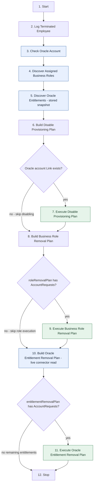

# Northstar Leaver workflow design

The owner reports a final `IdentityLifecycle` workflow named **Northstar Leaver Workflow**, with the following eight variables and twelve top-level steps. Their names and intended behavior were supplied; the exact exported XML, declared types, script bodies, coordinates, result mappings and transition placement were not. The [reconstructed XML](../../workflows/leaver/northstar-leaver-workflow.example.xml) is one explicit representation of that contract. It has not been imported or executed in IIQ. [Evidence boundary](../../docs/evidence/leaver-2026-11-26.md).

## Variables and data ownership

| Variable | Responsibility | Producer and consumers in the reconstruction |
|---|---|---|
| `identityName` | Exact IIQ Identity name supplied by the lifecycle event | Workflow input; identity lookup and all three LCM calls. It is not an Oracle username or an IIQ internal object ID. |
| `hasOracleAccount` | Whether a matching `Oracle Application` Link was discovered | Check Oracle Account returns Boolean through `resultVariable`; Build Disable transition uses it. This is Link discovery, not independent proof of a target account. |
| `assignedBusinessRoles` | Assigned roles whose Bundle type is `business` | Discovery returns a List of role names; Business Role plan builder reads it. Names rather than assignment IDs reflect this lab's scope. |
| `oracleRoles` | Early stored-Link snapshot of `ROLES` values | Discovery sets a Map keyed by native identity through `wfcontext.setVariable()`; diagnostic context only, not the final revocation input. |
| `oracleSystemPrivileges` | Early stored-Link snapshot of `SYSTEM_PRIVILEGES` | Discovery sets an equivalent Map. Exact connector values, including ADMIN_OPTION encoding, are retained. |
| `disablePlan` | Oracle Disable requests | Build Disable returns a ProvisioningPlan; Execute Disable passes `ref:disablePlan`. |
| `roleRemovalPlan` | Internal IIQ `assignedRoles` removals | Business Role builder returns a ProvisioningPlan; nonempty-plan transition guards its LCM call. |
| `entitlementRemovalPlan` | Oracle Modify requests for currently remaining entitlements | Live connector builder returns a ProvisioningPlan; nonempty-plan transition guards its LCM call. |

Map/List types above are reconstruction choices because original variable declarations were not supplied. Snapshot maps prevent conflating entitlements across different linked accounts. They do not supply the remaining-access plan: that builder re-reads each Oracle account after the Business Role branch converges.

## Conditional execution graph



Diamonds visualize transition conditions; they are **not extra workflow steps**. The example always builds `disablePlan`, which is empty when no Oracle Links exist, then branches around its execution. The reported material does not specify whether the original skip was placed before or after that builder; both express the required no-account behavior. Business Role cleanup still runs. Both role-removal branches converge at step 10, where current target entitlements are retrieved; an empty remaining-access plan goes straight to Stop.

## Every top-level step

| # / exact step name | Inputs | Responsibility and output | Transition |
|---|---|---|---|
| 1. Start | Lifecycle event's `identityName` | Entry into this workflow; no provisioning | Log Terminated Employee |
| 2. Log Terminated Employee | `identityName`, resolved Identity and `employmentStatus` | Record the synthetic subject and status using `loggerDex`; no claim of provisioning success | Check Oracle Account |
| 3. Check Oracle Account | Identity's `getLinks()` | Find Links for `Oracle Application`; return `hasOracleAccount` | Discover Assigned Business Roles regardless of Boolean result |
| 4. Discover Assigned Business Roles | Identity's `getAssignedRoles()` | Inspect Bundle type/name, retain type `business`; return `assignedBusinessRoles` | Discover Oracle Entitlements |
| 5. Discover Oracle Entitlements | Matching Links' `ROLES` / `SYSTEM_PRIVILEGES` | Normalize Collection/single/null values; set the two snapshot variables | Build Disable Provisioning Plan |
| 6. Build Disable Provisioning Plan | Identity and all matching Oracle Links | `plan.setIdentity()`; one Disable AccountRequest per matching Link; return `disablePlan` | If `hasOracleAccount`, Execute Disable; otherwise Build Business Role Removal Plan |
| 7. Execute Disable Provisioning Plan | `disablePlan`, `identityName` | Invoke LCM Provisioning for account locking; processing outcome belongs to the subprocess/request | Build Business Role Removal Plan when the subprocess returns; no success-result gate is implemented |
| 8. Build Business Role Removal Plan | Identity and `assignedBusinessRoles` | Internal `IIQ` Modify request; Remove each `assignedRoles` value; return `roleRemovalPlan` | Nonempty: Execute Business Role Removal Plan. Empty: Build Oracle Entitlement Removal Plan |
| 9. Execute Business Role Removal Plan | `roleRemovalPlan`, `identityName` | Invoke LCM Provisioning for role deassignment and configured role expansion/deprovisioning | Build Oracle Entitlement Removal Plan when the subprocess returns |
| 10. Build Oracle Entitlement Removal Plan | Identity, Oracle Links and each configured connector | Retrieve current account `ResourceObject`; build Remove requests for remaining `ROLES` and `SYSTEM_PRIVILEGES`; add only nonempty Modify requests; return `entitlementRemovalPlan` | Nonempty: Execute Oracle Entitlement Removal Plan. Empty: Stop |
| 11. Execute Oracle Entitlement Removal Plan | `entitlementRemovalPlan`, `identityName` | Invoke LCM Provisioning for remaining target entitlement removal | Stop when the subprocess returns |
| 12. Stop | Reached execution path | End this workflow; does not assert every target action succeeded or every form of access was removed | No outgoing transition |

The reconstruction rejects an unresolved Identity and a blank matching native identity. Connector failures propagate rather than being interpreted as an empty account. These are explicit example safeguards, not evidence of the unavailable original scripts. There is no custom retry, error branch, result-validation step or automatic reconciliation step in these twelve steps.

## LCM Provisioning subprocess contract

| Step | `plan` argument |
|---|---|
| Execute Disable Provisioning Plan | `ref:disablePlan` |
| Execute Business Role Removal Plan | `ref:roleRemovalPlan` |
| Execute Oracle Entitlement Removal Plan | `ref:entitlementRemovalPlan` |

All three receive `identityName = ref:identityName`, `approvalScheme = none`, `foregroundProvisioning = true`, and `notificationScheme = none`. Each references the configured **LCM Provisioning** workflow by name. Approval and notification processing were disabled for this controlled, automated offboarding lab so that the configured termination response would not wait for manual approvals or send routine notifications. This describes the lab's chosen arguments; it does not establish a general production policy or prove no customized child workflow could attempt a notification.

`foregroundProvisioning` requests foreground processing along the configured path. It does **not** guarantee connector success, eliminate partial results, or substitute for inspecting provisioning results and Oracle state. The parent currently does not collect and validate all subprocess results before advancing; automated result handling is a [future enhancement](future-enhancements.md).

Reconstructed invocation shape:

```xml
<Step name="Execute Oracle Entitlement Removal Plan" icon="Provision">
  <Arg name="plan" value="ref:entitlementRemovalPlan"/>
  <Arg name="identityName" value="ref:identityName"/>
  <Arg name="approvalScheme" value="none"/>
  <Arg name="foregroundProvisioning" value="true"/>
  <Arg name="notificationScheme" value="none"/>
  <WorkflowRef>
    <Reference class="sailpoint.object.Workflow" name="LCM Provisioning"/>
  </WorkflowRef>
  <Transition to="Stop"/>
</Step>
```

## Nonempty-plan guards

The owner supplied this entitlement-plan transition condition:

```java
return entitlementRemovalPlan != null
    && entitlementRemovalPlan.getAccountRequests() != null
    && !entitlementRemovalPlan.getAccountRequests().isEmpty();
```

The equivalent Business Role guard is:

```java
return roleRemovalPlan != null
    && roleRemovalPlan.getAccountRequests() != null
    && !roleRemovalPlan.getAccountRequests().isEmpty();
```

In XML these are nested `Transition/Script/Source` conditions, followed by an unconditional fallback transition. The role guard's fallback is **Build Oracle Entitlement Removal Plan**, never Stop. The entitlement guard's fallback is Stop. A plan containing an empty AccountRequest would pass a request-count guard, so the builders also omit Modify requests with no AttributeRequests.

Keep all twelve `Step` elements as direct children of `Workflow`. A well-formed XML document can still incorrectly nest one Step inside another; both structure and transitions need inspection. The [SailPoint step reference](https://documentation.sailpoint.com/identityiq_83/help/businessprocesses/wf_step_elements.htm) documents ordered transitions, `resultVariable`, arguments and subprocess references. These configuration constructs are separate from proof of a successful target operation.
