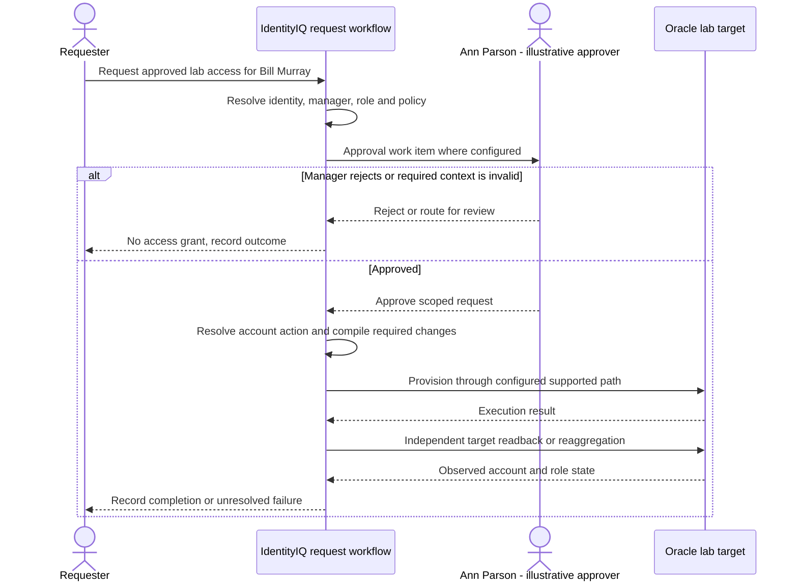

# Access request and manager approval

**Historical status: Previously Completed, Evidence Pending.** The owner reported Ann Parson approving an access request involving Bill Murray and subsequent Oracle provisioning experiments. The exact original request, approval log and target readback are unavailable. The flow below is an illustrative reconstruction and proposed verification path.

## Objective and requirement

Grant a synthetic workforce identity the approved technical access represented by a business request, with NH-05/NH-09 evidence linking the decision to target enforcement.

## Prerequisites, steps and expected behavior

An isolated Oracle target, reviewed connector permissions, stable identity correlation, resolved manager, a narrow synthetic entitlement and an appropriate IIQ request workflow are prerequisites. Inspect whether the role requires or merely permits its associated IT Role; permission to request an optional role is not an automatic grant.

Request one scoped entitlement, record the request reference, inspect approver resolution, then approve or reject through the intended configured workflow. Inspect the compiled account/attribute operations and final connector outcome. Query the database independently and reconcile the resulting account. An approval or a queued request alone must not be recorded as completed provisioning.

## Actual results, troubleshooting and limitations

No runtime test was conducted here. Verify manager resolution, work-item ownership, entitlement requestability, provisioning policy fields, connector status, Oracle account/native identity and identity refresh if expected access is missing. The historical `DBA Business → DBA IT → DBA` experiment is documented in [role modeling](../sailpoint-identityiq/roles-and-entitlements/README.md); use a narrow custom lab role for future tests.

## Security and next improvement

Do not bypass approvals with a direct executor solely to make a demonstration succeed. Log decisions without full credential-bearing plans. Test a rejected request, unresolved manager and failed connector operation alongside the approved request; see [test scenarios](test-scenarios.md).
