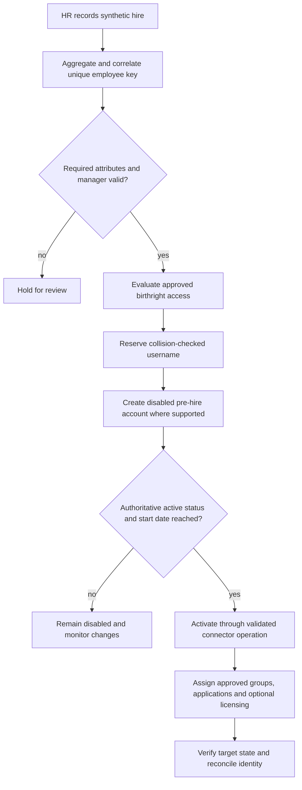
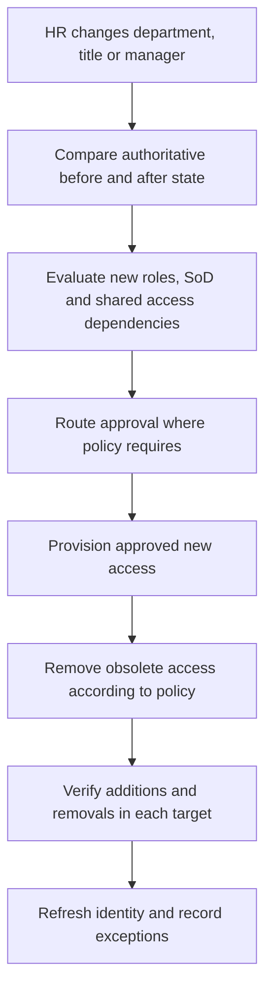
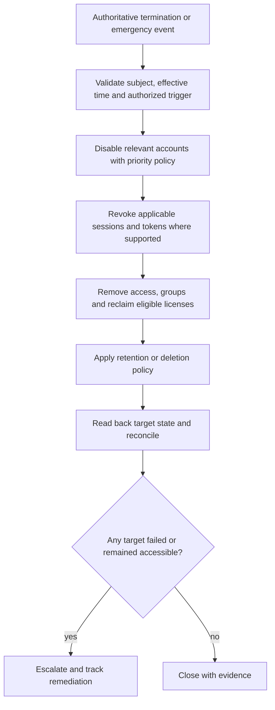

# Joiner, mover and leaver lifecycle

## Current status — November 26, 2026

| Lifecycle | Current owner-reported status | Documentation |
|---|---|---|
| Joiner | Implemented and tested | [Preserved work and current source/evidence limits](../labs/joiner/README.md) |
| Mover | Planned | Broader design below; no execution claimed |
| Leaver | Implemented, with primary provisioning scenarios tested | [Implemented lab design](../labs/leaver/README.md), [conditional workflow](../labs/leaver/workflow-design.md), [four tests](../labs/leaver/test-scenarios.md) |

The Leaver responds to `employmentStatus` Active → Terminated after HR aggregation and Identity Refresh with Process Events. It locks discovered Oracle accounts, removes assigned Business Roles, then reads current Oracle account data through the connector to remove remaining `ROLES` and `SYSTEM_PRIVILEGES`. Mary's complete final no-account path still needs regression testing. [E-005](../docs/evidence/leaver-2026-11-26.md) records source/evidence gaps.

## Preserved broader lifecycle design

The original planning material below remains a **proposed broader design**, including pre-hire activation, session revocation, retention, automated exceptions and multi-application coverage. Those broader controls are not established by the reported Joiner status or Oracle Leaver tests. The final implemented twelve-step Leaver is documented separately above.

## Objective, business requirement and prerequisites

Implement NH-01 through NH-09 from the [business scenario](README.md), beginning with one synthetic person and one target. Required: a verified authoritative HR mapping, unique stable key, resolved manager, target connector permissions, defined approval policy and an isolated rollback baseline. AD/hybrid steps additionally need supported domain and synchronization infrastructure; they are not prerequisites for a first direct Oracle experiment.

## Joiner and pre-hire

Sarah Miller's `smiller` is a proposed base name, not a unique reservation or confirmed provisioned account. Define the timezone, start-of-day activation policy, future HR corrections and cancellation behavior before scheduling. Creating a disabled account does not prove all application/session paths are blocked; test applicable enforcement. Licensing needs product eligibility, required usage-location data and a chosen assignment method, not a presumed universal group operation.

## Mover

Order additions and removals according to risk and continuity requirements; the depicted sequence is an example, not a guaranteed transactional change. A role no longer matching a title does not by itself prove all obsolete direct grants were revoked. Check competing roles and manually assigned access before removal.

## Leaver

Disablement, session revocation, entitlement removal and deletion are different operations. Token/session behavior is target-dependent; do not claim immediate universal logout. Emergency termination requires a defined authorized escalation path independent of routine HR batch latency. Retention and deletion require an approved policy; a teaching diagram does not define one.

## Implementation sequence and verification

1. Baseline the installed platform and capture an HR aggregation/correlation replay.
2. Test the conditional Oracle workflow with a narrow synthetic role before using broad entitlements.
3. Implement one joiner path with documented preconditions; capture source event, decisions, request, target readback and reconciliation.
4. Add pre-hire activation and cancellation, missing manager, duplicate key and username collision tests.
5. Implement mover additions/removals and verify shared-role dependencies.
6. Implement leaver disablement first, then target-specific session/access removal and retention, including failure escalation.

Expected broader behavior is defined in [test scenarios](test-scenarios.md). Those broader acceptance scenarios were originally not run; the current narrower Leaver outcomes are in the [Leaver test matrix](../labs/leaver/test-scenarios.md). No original import-ready lifecycle export is supplied; added Leaver XML is reconstructed/unexecuted. Avoid duplicate event handling with persistent request keys and readback before retry; serialize conflicting changes for a person and record partial target failures rather than pretending cross-system rollback is atomic.

## Additional planned scenarios

| Scenario | Control to design before testing |
|---|---|
| Rehire | Match stable key, inspect retained accounts and reapprove access rather than restoring everything |
| Contractor onboarding and extension | Sponsor, end date, renewal approval and automatic expiry |
| Temporary access | Explicit purpose, approver, expiry and verified removal |
| Leave of absence | Suspend/reactivate policy distinct from termination |
| Internal promotion/department transfer/manager change | Attribute ownership, role recalculation and approval rerouting |
| Employee-to-contractor conversion | Relationship transition, authoritative-source precedence and access reset |
| Orphan account remediation | Owner investigation and authorization before disable/delete |
| Dormant accounts | Reliable activity evidence, exclusions and approved remediation |
| Service accounts | Named owner, purpose, credential rotation, noninteractive use and retirement criteria |

Security: use synthetic identities, least-privilege connectors and reviewed logs. Exact current lifecycle exports, connector configuration and downstream permissions have not been inspected. Next improvement: retest the final no-Oracle-account Leaver branch and retain original sanitized evidence before expanding to AD or cloud activation.
