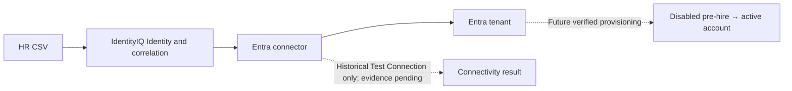

# IdentityIQ to Microsoft Entra ID connector

**Connectivity status: Previously Completed, Evidence Pending.** The maintainer reports creating an IIQ application, authenticating with an Entra client secret, and passing Test Connection. Original configuration and results are unavailable. **Lifecycle provisioning: In Progress / planned validation.** End-to-end onboarding has not been demonstrated.

## Objective and business requirement

Connect governed workforce identities to a cloud directory, then develop controlled pre-hire provisioning. Northstar Health's fictional Sarah Miller needs an account before her start date, with activation and access governed separately.

## Prerequisites and architecture

Use a dedicated lab tenant, a licensed IIQ connector supported by the installed release, an app registration/service principal with reviewed least-privilege permissions and consent, and private secret storage. Record permission *names* and authentication mode without publishing tenant IDs, credential values, or exports.

A working connection proves a limited authentication/connectivity check, not successful user creation, entitlement assignment, licensing, SSO, or Active Directory integration.

## Historical scope and configuration

- An Entra application was created in IIQ and tested with a client secret.
- Account schema was inspected, with `displayName` used for display.
- Matching IIQ Employee ID to Entra `employeeId` was studied. The exact IIQ attribute name, uniqueness policy, and successful correlation result remain unverified.
- Pre-hire provisioning, activation, username generation, and licensing were discussed or partially configured; complete automation is unverified.

`displayName` is a readable label and should not be used as a unique person key. Inspect the connector's immutable/native account identifier. For cloud user properties and permissions, compare the [IIQ connector account attributes](https://documentation.sailpoint.com/connectors/identityiq/microsoft/entra_id/help/integrating_entra_id/account_attributes.html) with [Microsoft Graph's user resource](https://learn.microsoft.com/en-us/graph/api/resources/user?view=graph-rest-1.0). Graph models `employeeId` as a string; it must be populated and checked for duplicates before using it for correlation.

## Implementation steps for a controlled rerun

1. Record IIQ/connector release, tenant type, authentication mode, permission names, secret expiration policy, and tested operation.
2. Run Test Connection and save only a sanitized result with timestamp/version. Keep the actual secret private.
3. Aggregate a narrowly scoped synthetic test account and inspect its schema/native identity.
4. Validate `employeeId` matching against one unique IIQ employee ID; include missing and duplicate ID cases.
5. Inspect the installed connector's Create policy and required fields. Prefer supported configuration before a custom rule.
6. Test a disabled Sarah account. The local-part convention is first initial + last name (`smiller`), but collision handling, normalization, allowed characters, suffix length, and reservation across targets need a defined policy. A local part alone is not a valid UPN; a real tenant-verified domain is needed at execution.
7. Validate creation, readback, and disabled state before testing activation. Activate only when the authoritative status/date and approval controls permit it.
8. Test a narrow group/application entitlement separately, then licensing if required and available. These are independent acceptance criteria.
9. Test cleanup, error retention, retries, and reconciliation before expanding the scope.

## Code and configuration

No runnable Graph request or original IIQ application export is included. Connector policies and direct Graph payloads differ; do not paste a Graph `passwordProfile` object into an IIQ policy without checking its schema. SailPoint's versioned [Create Account Policy](https://documentation.sailpoint.com/connectors/identityiq8_3/microsoft/entra_id/help/integrating_entra_id/create_account_policy.html) documents `accountEnabled=false` for disabled creation. Its compatibility with this unidentified local IIQ release still needs checking.

Microsoft Graph's [create-user API](https://learn.microsoft.com/en-us/graph/api/user-post-users?view=graph-rest-1.0) specifies required properties and tenant-domain constraints. A license assignment is a separate operation with its own permission and SKU requirements; see [assignLicense](https://learn.microsoft.com/en-us/graph/api/user-assignlicense?view=graph-rest-1.0). Do not assume every new employee needs a Microsoft 365 license.

## Expected behavior and test procedure

| Test | Expected observation to verify |
|---|---|
| Connection | Authentication/connectivity result only |
| Correlation | Correct existing IIQ Identity owns test account Link |
| Disabled Create | Correct account exists; `accountEnabled=false` on readback |
| Activation | Same account enabled only under authorized lifecycle condition |
| Name collision | Defined alternative or controlled exception; no overwrite |
| Entitlement/license failure | Separate visible failure; no false complete-onboarding claim |
| Repeat event | Stable account identity and no duplicate grants |

## Actual results and troubleshooting

Only the maintainer's reported connection success and schema exploration are recorded; no new tenant operation was performed. For failures, check credential expiry, consent/permissions for the specific operation, source ID consistency, native account identity, required Create fields, verified domain, and provisioning result. Do not add broad directory permissions without identifying the missing operation.

## Security, limitations, and next improvement

Use a lab app credential, rotate secrets, scope permissions and account filters, and avoid retaining raw tokens/logs. No AD provisioning, Entra synchronization, SAML/OIDC configuration, or complete Joiner workflow is established by this connector test. Next, complete one disabled-account Create → readback → cleanup exercise with sanitized evidence. Broader topics belong in the [Entra learning section](../../../microsoft-entra-id/README.md).
