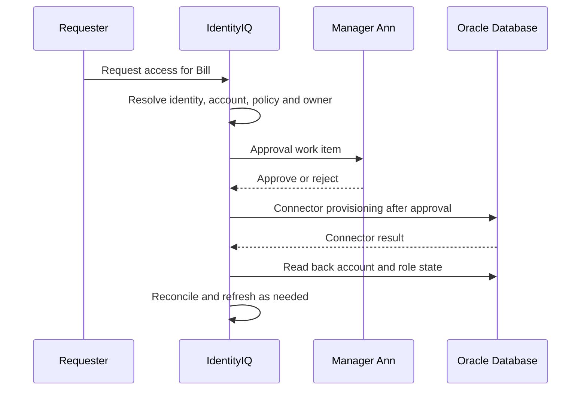

# Oracle Database aggregation and access provisioning

**Later implementation:** [E-004](../../../docs/evidence/oracle-create-modify-2026-11-20.md) contains captured scoped Create/Modify execution. The [November 26 Leaver Lab](../../../labs/leaver/README.md) adds owner-reported account locking, role-based deprovisioning, live connector retrieval and remaining `ROLES` / `SYSTEM_PRIVILEGES` removal, with [read-only verification SQL](../../../scripts/sql/verify-oracle-offboarding.sql). Original Leaver exports/results were not supplied. The historical Ann/Bill narrative and configuration limitations below remain at their original evidence scope.

**Status: Previously Completed, Evidence Pending.** The maintainer describes successful access-request and provisioning experiments, including Ann Parson approving a request involving Bill Murray. Original application exports, request records, and database results have not been inspected.

## Objective and business requirement

Govern a database account and its access through IIQ, then prove the target database actually contains the approved change. Northstar Health needs accountable approval and access evidence rather than assuming a completed request screen proves access.

## Prerequisites

- Isolated Oracle Database instance and confirmed service/PDB, version, networking, and credential handling.
- Licensed IIQ with the **Oracle Database** connector and release/patch-specific prerequisites. This is not Oracle Fusion HCM, Oracle E-Business Suite, or Oracle Identity Manager.
- A connector account with only documented required permissions and a separate authorized account for verification.
- A correlated synthetic identity, manager relationship, entitlement owner, and test approval route.

The historical runtime used Docker image `gvenzl/oracle-free:23-slim`, SQL*Plus, and DBeaver on Apple Silicon. The image tag is user-reported; image digest, architecture/emulation, PDB/service, mapped port, and exact release output are not available. Do not infer that the old Oracle 11g exercise or every IIQ connector version supports this environment. SailPoint explicitly cautions that connector configuration varies by release and patch. [Oracle Database connector introduction](https://documentation.sailpoint.com/connectors/identityiq/oracle/database/help/integrating_oracle_database/introduction.html).

## Architecture

This diagram reconstructs the intended flow; it is not a captured trace. The connector's documented categories include account management, role/group management, and entitlements. Verify the actual schema's entitlement attribute locally rather than assuming a field named `roles`. [Supported features](https://documentation.sailpoint.com/connectors/identityiq/oracle/database/help/integrating_oracle_database/supported_features.html).

## Implementation steps

1. Record the Oracle version, service/PDB, connector version, and application name without credentials. Verify connectivity from the IIQ runtime, not only from DBeaver.
2. Review the account schema and identify its native identity and entitlement attributes. Discover or configure schema following the installed connector guide.
3. Aggregate accounts to read users and their attributes. Aggregate account groups/entitlements as supported to populate governable role objects and their metadata. Reading users and reading the entitlement catalog are distinct activities.
4. Correlate the target test account to the correct employee. An account native identity such as `BILL_MURRAY` is not necessarily the IIQ Identity name or employee ID.
5. Give the test entitlement an owner and clear description. Use a narrow lab role for new exercises. The historical DBA example is documented for understanding, not prescribed as birthright access.
6. Inspect role/requestability settings and approval policy. Confirm Ann is the manager in the tested request context; the narrative does not provide the exact historical approval configuration.
7. Submit one request, record its ID locally, inspect the approval work item, and capture approval or rejection without secret/personal data.
8. Inspect the provisioning result and any pending/manual/failed state. Confirm the external role grant independently, then reconcile and refresh where needed.
9. Revoke the test access through the supported request/remediation path and verify removal. A successful grant alone is not a complete access lifecycle test.

## Code and configuration

[Read-only Oracle verification SQL](../../../scripts/sql/oracle-verification.sql) checks the connected session and role grants. No account-creation or DBA-grant script is provided. The exact connector application and original provisioning plans are unavailable.

| IIQ object/concept | Meaning in this lab |
|---|---|
| ProvisioningPlan | Requested changes for an identity; not proof of execution |
| AccountRequest | Per-application account operation such as Create or Modify |
| AttributeRequest | Requested attribute/entitlement operation, using connector schema |
| Approval work item | Human decision before permitted execution |
| Provisioning result | Processing outcome that must be interpreted with target readback |
| Link | Aggregated account representation associated with an Identity |

See [role modeling](../../roles-and-entitlements/README.md) and the repository's custom-workflow section for the unfinished conditional Create/Modify project.

## Expected behavior and test procedure

| Scenario | Expected observation to verify |
|---|---|
| Approve valid narrow-role request | Correct account receives only approved role |
| Reject request | No target change |
| Missing/unresolved manager | Defined exception route; no accidental approval bypass |
| Connector failure | Failure retained and investigated, not reported as success |
| Repeat approved action | No unintended duplicate account or extra access |
| Revoke role | Target grant absent after supported remediation |

Record source/target before-and-after state, request decision, connector status, and reconciliation result. A role-detection refresh is separate from executing the external change. [Updating the Identity Cube](https://documentation.sailpoint.com/identityiq_83/help/provisioning/updating_the_identity_cu.htm).

## Actual results and troubleshooting

The maintainer reports exploring Oracle account/role aggregation, access requests, approvals, provisioning, and target verification. Ann/Bill and the `DBA Business` → `DBA IT` → `DBA` model are reported history only. Some assignments did not produce expected entitlements immediately; refresh/role evaluation and role warnings were investigated. No fresh database or IIQ test was run here.

Investigate native-identity case, correct PDB/service, correlation, approval state, role relationship, provisioning-policy required fields, connector permissions, and task options before retrying. Do not reinterpret a UI warning as a known cause without its exact message. Distinguish a queued/manual result from a target commit, and a stale Link from a failed external grant.

## Security, limitations, and next improvement

`DBA` is highly privileged; `CONNECT` and `RESOURCE` are predefined roles whose effective permissions should be inspected in the actual release. They are not interchangeable with a narrowly scoped application role. Avoid adding broad privileges to make a connector error disappear. Keep passwords, connection secrets, raw plans, and proprietary driver binaries out of Git. Next, rerun a narrow-role request with rejection, grant, readback, and revocation evidence.
