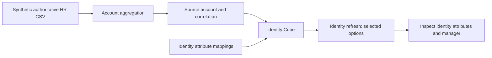

# Authoritative aggregation and Identity Cubes

**Status: Previously Completed, Evidence Pending.** The maintainer describes CSV aggregation, mapping, refresh, and Identity Cube creation. No task results, original application definitions, or screenshots have been inspected. Procedures below are a reconstruction for a future controlled rerun, not a record of a new successful test.

## Objective and business requirement

Build an employee identity from an authoritative HR record, then attach application accounts to the correct person. Northstar Health needs a stable employee identifier before it can make reliable access decisions. Its simulated Workday source is CSV; this repository does not demonstrate a Workday connector.

## Prerequisites

- Licensed local IdentityIQ instance and permission to configure applications and tasks.
- Confirmed IIQ version/patch and connector documentation for that release. The version is currently unknown.
- Isolated synthetic dataset and a baseline count of identities and accounts.
- A chosen authoritative source and documented ownership of identity attributes.

## Architecture

Account aggregation reads source account objects into IIQ. An Identity Cube is IIQ's combined identity view, not a copied CSV row. Account attributes live on the application's account representation (a Link); identity attributes represent the person across sources. Correlation links an account to a person. Identity refresh can reevaluate derived identity information, roles, and lifecycle behavior according to selected task options. Review the options before running a refresh; some can trigger provisioning. [SailPoint application concepts](https://documentation.sailpoint.com/identityiq_84/help/appconfig/applicationconcepts.html), [Account aggregation](https://documentation.sailpoint.com/identityiq_84/help/tasks/account_aggregation.html), [Identity refresh](https://documentation.sailpoint.com/identityiq_84/help/tasks/identity_refresh.html).

## Implementation steps

1. Record the current identity count and inspect existing source definitions. Do not add all historical CSV applications as authoritative at once.
2. Select one [synthetic HR fixture](../../sample-data/synthetic/northstar-hr.csv). Copy it to a location readable by the IIQ runtime, with access restricted to the lab operator.
3. Create an isolated delimited-file application. Specify the header, comma delimiter, and string schema fields. Use `employeeID` as the account identity attribute and `fullName` as its display attribute for this example.
4. Configure the source as authoritative only after confirming the intended identity-creation behavior. Account identity and display attributes do not independently establish global person correlation.
5. Configure the Identity mappings in the installation's identity configuration. Example: source `firstName` → Identity `firstname`, `lastName` → `lastname`, `fullName` → `displayName`, `email` → `email`, and `employeeID` → the installation's chosen employee-ID attribute. Custom identity attribute names must be checked locally.
6. Configure account and manager correlation deliberately; see [correlation](../identity-correlation/README.md). Check uniqueness before using any matching attribute.
7. Run an aggregation scoped to this application. Inspect task completion, rejected rows, source account data, and the resulting identities.
8. Run only the needed identity-refresh options. Inspect the resulting attributes and manager relationship. Save sanitized observations and counts.
9. Change a single synthetic attribute, rerun aggregation/refresh, and verify that it updates the same identity instead of creating a second one.

## Code and configuration

The canonical data is in [sample-data](../../sample-data/synthetic/README.md). [HR schema and mapping](../applications/hr-csv/README.md) describes the fixture fields. No original application XML is included. UI labels and mapping precedence may differ by release.

## Expected behavior and test procedure

| Check | Expected result for an isolated fresh fixture | Evidence to retain |
|---|---|---|
| Initial aggregation | Five source accounts; identities follow configured authoritative creation/correlation | Task summary and sanitized identity search |
| Identity mapping | Names/email populated on Identity, not just Link | Before/after attribute table |
| Second identical run | No additional person identities | Counts plus employee-ID search |
| Attribute change | Same Identity updated | Stable IIQ identity ID, sanitized before/after |
| Manager | Bob resolves to Ann after manager matching | Manager field and source identifier |
| Invalid/missing ID | Rejected or quarantined under documented handling | Error result; no guessed correlation |

Do not treat an aggregate count as proof that every account correlated correctly. Inspect every fixture record. Identity names, internal IDs, account native identities, and employee IDs may be different values.

## Actual results

Historical account aggregation, schema discovery, identity mapping, and refresh are described by the maintainer for ACMEE HR, Practice CSV, NorthStar HR CSV, Friends CSV, and Northstar Workday HR (simulated CSV). The original configurations and results are unavailable. No new IIQ execution was performed when these documents were authored.

## Troubleshooting

- **Only employeeID appears:** inspect the Link first. If it contains names, inspect identity mapping/precedence and refresh. If it does not, inspect the CSV header, schema, delimiter, encoding, and query/source output.
- **Missing manager:** confirm that the manager identity exists, that its identifier is unique, and that the selected source manager field contains that identifier.
- **Unexpected duplicates:** stop repeated aggregations and inspect authoritative flags and correlation before changing or deleting identities.
- **Unexpected automation:** compare refresh options with the baseline. A refresh is not always a read-only operation.

## Security, limitations, and next improvement

Use synthetic data, exclude raw IIQ exports and logs, and keep runtime files outside the repository where necessary. Avoid enabling provisioning merely to populate a display attribute. This procedure does not supply release-specific application XML or claim a supported deployment matrix. Next, rerun this five-record lab and add sanitized evidence using the repository's evidence conventions.
