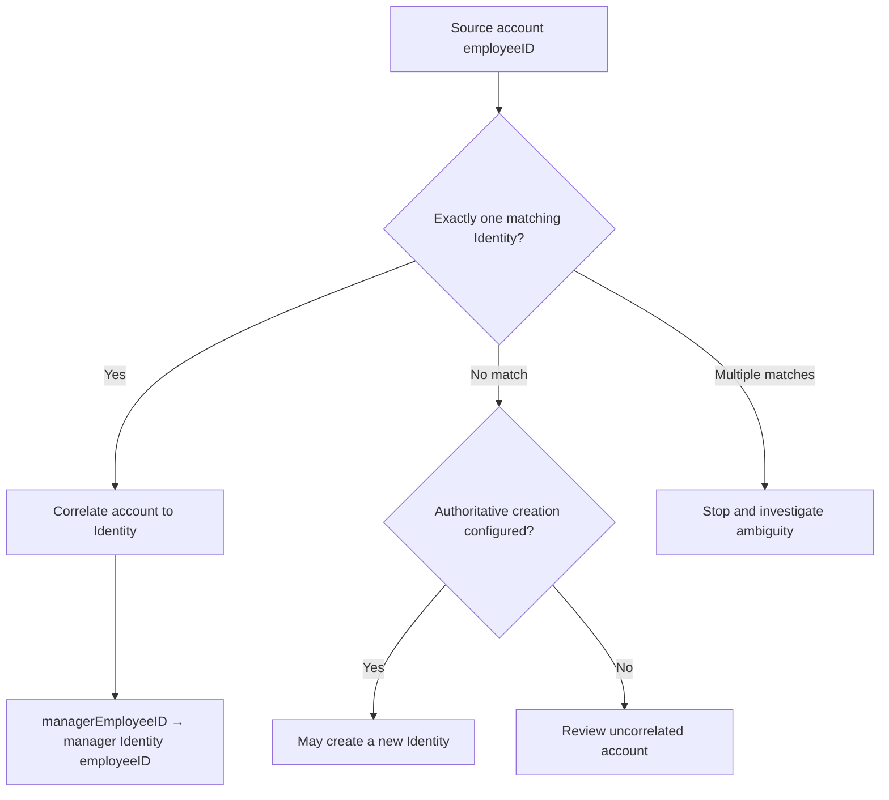

# Account, manager, and duplicate-identity correlation

**Status: Previously Completed, Evidence Pending.** This documents the maintainer's experiments and a proposed verification procedure. Original correlation configuration and execution evidence have not been inspected.

## Objective and business requirement

Associate each Northstar Health account with the correct person, resolve each employee's manager, and explain why multiple authoritative sources can create duplicate identities. Incorrect matching can grant access to the wrong person or route approvals to the wrong manager.

## Prerequisites and architecture

Use an isolated IIQ lab with synthetic accounts, permission to inspect Identity and Link attributes, and a baseline of authoritative-source settings. Choose a stable, unique, normalized employee identifier. Names and mutable email addresses are weak long-term primary keys.

This is a conceptual decision model, not a complete specification of every IIQ aggregation setting. SailPoint supports attribute, condition, rule, and manual correlation. Manager correlation independently resolves the manager reference. [Correlation overview](https://documentation.sailpoint.com/identityiq_84/help/appmgmt/correlation.html), [Account and manager correlation](https://documentation.sailpoint.com/identityiq_84/help/rapidsetup/idandmancorrelation.html).

## Implementation steps: stable account matching

1. Inspect the actual identity attribute used for employee ID; `employeeID` is the fixture convention, not a promise about the installed Identity schema.
2. Confirm that every source account has a nonempty identifier. Treat IDs as strings so leading zeros survive.
3. Search existing identities by that attribute. Require one unambiguous match for a secondary account; do not select the first result from a list of duplicates.
4. Configure a source-to-identity match, then aggregate only that application.
5. Inspect the Link's owner and native identity. Confirm no new person was created unexpectedly.
6. Test unmatched and ambiguous cases in the sandbox. Define review behavior before moving to larger datasets.

## Manager experiment: Bob Fields → Ann Parson

The historical scenario says Bob's HR manager identifier pointed to Ann. Exact historical identifier values were not provided. The new [fixture](../../sample-data/synthetic/northstar-hr.csv) **illustratively** uses Ann `100`, Bob `200`, and Bob's `managerEmployeeID=100`.

1. Aggregate Ann and Bob and inspect their identity employee-ID values.
2. Map source `managerEmployeeID` to the chosen Identity employee-ID attribute in manager correlation.
3. Run the required aggregation/refresh sequence for the installed release.
4. Inspect Bob's manager field as an Identity relationship, not merely the string `100`.
5. Confirm the resolved Identity is Ann. Inspect a potential approval route without submitting an unnecessary access change.

Missing manager records, blanks, case/whitespace differences, an incorrect target attribute, duplicate manager IDs, mapping precedence, and refresh timing can prevent resolution. Ann's blank manager in the fixture represents a top-level manager; it should not be forced to match an arbitrary identity.

## Duplicate experiment: Mitch Armstrong, employee 401

The maintainer reports duplicate Identity Cubes when Mitch appeared in multiple authoritative sources. A plausible mechanism is that the second authoritative account did not match the existing person under the tested identity-creation/correlation settings, so another identity was created. The precise cause cannot be proven without the original application definitions and task results.

The [secondary fixture](../../sample-data/synthetic/secondary-authoritative.csv) deliberately repeats employee `401`. It is a negative-test input; do not aggregate it as authoritative into an important lab without first taking a recoverable baseline.

1. Inventory each source's authoritative flag, identity attribute, account-correlation configuration, and attribute precedence.
2. Search all identities and Links containing `401`; compare internal Identity IDs and source account native identities.
3. Check whether `401`, `0401`, a number, or a whitespace-padded string entered different mappings.
4. Confirm whether the second source was meant to own person creation or merely supply application accounts.
5. Correct the source design and retest in an isolated dataset. Reaggregation alone must not be assumed to merge existing duplicates.
6. Design any manual merge/remediation only after inspecting account ownership, role assignments, approvals, and audit impact. No automated merge code is supplied here.

Prevention candidates are one primary HR authority, an explicit multi-source identity strategy, unique workforce IDs, controlled source precedence, and correlation tests before aggregation. These are proposed controls, not a completed duplicate-resolution framework. Account correlation attaches accounts; it does not establish that two existing Identity objects have safely been consolidated.

## Expected behavior and test procedure

| Input | Expected outcome to verify |
|---|---|
| Valid secondary account with known unique employee ID | Link on existing person, no extra person |
| Bob manager `100` | Manager is Ann's Identity |
| Unknown manager ID | Unresolved result investigated, no guessed manager |
| Missing employee ID | Documented exception handling |
| Two candidate Identities for employee 401 | Ambiguity investigated before granting access |
| Unchanged repeat aggregation | Stable ownership and identity counts |

Save sanitized task summaries, matching-attribute values, identity counts, and Link ownership. Expected outcomes above have not been observed in a new run.

## Actual results, security, limitations, and next improvement

The Bob/Ann manager relationship and Mitch duplicate behavior come only from the maintainer's account. No original rules, XML, or screenshots were inspected. Correlation changes can affect ownership and access; test with synthetic records and keep complete local rollback evidence. Next, capture a minimal positive/negative correlation test before changing any production-style lifecycle logic.
