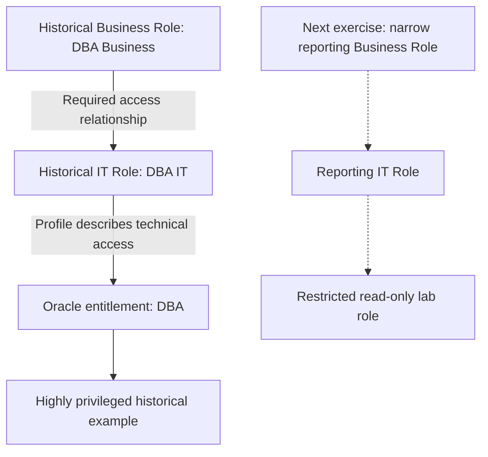

# Business roles, IT roles, and Oracle access

**Later deprovisioning test:** Sarah Miller's November 26 [Leaver scenario](../../labs/leaver/test-scenarios.md) used **`dba - Business` → required `dba - IT` → five Oracle roles**. The owner reports successful deassignment, all five role grants revoked, and subsequent aggregation/refresh reconciliation. This is a different specifically named configuration from the historical `DBA Business → DBA IT → DBA` example below. Do not rename or conflate them. [Implementation details and limits](../../labs/leaver/implementation.md).

**Status: Previously Completed, Evidence Pending.** The maintainer explored Business Roles, IT Roles, Oracle entitlements, assignment behavior, refresh, and job-title assignment. No original role definitions or successful automatic-provisioning trace were inspected.

## Objective and business requirement

Translate a Northstar Health job responsibility into understandable, reviewable technical access. A manager should understand why access is needed while an application owner validates what it permits.

## Prerequisites and architecture

Use an isolated IIQ lab, an aggregated Oracle entitlement catalog, correlated accounts, a documented approval route, and permission to inspect role configuration. Role types and requestability can be customized, so inspect the local installation before applying a default model.

Business Roles express job functions; IT Roles group technical access. Linking required IT access to a Business Role is different from permitted, discretionary access. Cross-type role links should use supported Required/Permitted relationships rather than assuming inheritance. A managed entitlement is not the same as the older IIQ `Entitlement` role type. [SailPoint role types](https://documentation.sailpoint.com/identityiq_83/help/rolemgmt/role_types.htm), [Required and permitted access](https://documentation.sailpoint.com/identityiq_83/help/rolemgmt/required_access_and_perm.htm).

## Implementation steps

1. Inspect the Oracle account schema and entitlement values, including case. Confirm the catalog object represents the actual target role.
2. Review the `DBA IT` profile and application/entitlement selector. Do not infer technical access from the role's name alone.
3. Review the `DBA Business` relationship to the IT role. Record whether it is Required or Permitted and the intended provisioning outcome.
4. Inspect role type configuration, requestability, constraints, ownership, and approval requirements before requesting access.
5. Assign/request only the isolated test role through the chosen supported path. Capture approval and provisioning state.
6. Inspect target access independently. Then run appropriate role-detection/refresh options and compare assigned roles, detected roles, and actual entitlements.
7. For job-title assignment, first validate the identity attribute and exact matching criteria. Scope the initial refresh to one test identity and inspect whether provisioning options are enabled.
8. Test deassignment and entitlement removal deliberately. Shared entitlements may still be required by another role; do not promise that every role removal revokes every underlying grant.

## Code and configuration

No role-export XML or automatic-assignment rule is supplied as a historical artifact. Oracle account/readback material is in the [Oracle lab](../applications/oracle/README.md). Prefer supported role configuration before adding custom scripts.

## Expected behavior and test procedure

| Test | Verification |
|---|---|
| Requestability | Desired Business Role available in the intended request UI |
| Required IT role | Technical access represented in resulting request/plan |
| Permitted IT role | Not assumed to be automatically granted |
| Approved grant | Target role present on correct account |
| Refresh/detection | IIQ view reconciles with observed target state |
| Job-title rule | Only intended test identity qualifies |
| Deassignment | Removal or documented retained shared access verified |

Do not treat a detected role as proof of an approved assignment. Do not treat an assigned role as proof the connector committed its entitlements. SailPoint distinguishes role evaluation from external provisioning in its [identity-refresh-driven assignment guidance](https://documentation.sailpoint.com/identityiq_84/help/provisioning/identity_refresh_driven_.html).

## Actual results and troubleshooting

Historical observations include Business Roles appearing in assignment/request locations where IT Roles did not, linking IT Roles to Business Roles, assignments without immediate expected entitlement changes, role warning/error indicators, and job-title-based assignment investigation. No claim is made that every automatic assignment worked.

Check requestable role types in Lifecycle Manager configuration, role-specific settings, Required versus Permitted links, missing profile/application references, approval status, provisioning result, and refresh options. The official [global role settings](https://documentation.sailpoint.com/identityiq/help/roles_groups_and_populations/roles/global_config_setting_roles.html) identify the requestable-role-type configuration. UI visibility alone does not show a product limitation. Record exact warning text before proposing a fix.

## Security, limitations, and next improvement

`DBA` is too broad for ordinary employee birthright access. Retain it as a clearly identified historical privileged experiment, and use a limited reporting role for new end-to-end tests. Role mining and Separation of Duties are planned future work; no toxic-combination policy or mining outcome is claimed. Next, demonstrate a narrow-role request, denial, approval, readback, and removal with evidence.
