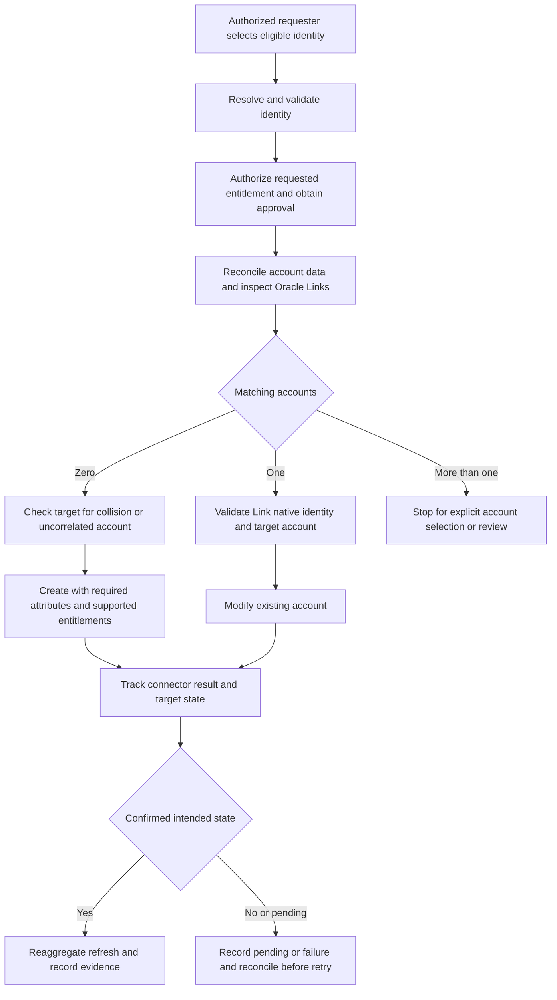

# Work in progress: conditional Oracle access workflow

**Status: In Progress.** The owner has experimented with forms, variables, workflow XML, scripts, logging, and provisioning-plan composition. No original workflow export, request trace, connector result, or target verification has been inspected. The design below is newly authored from that narrative. No end-to-end success is claimed.

## Objective and business requirement

Let an authorized Northstar Health requester select an eligible identity and request approved Oracle access whether or not the employee already has an Oracle account. Existing account ownership is a provisioning decision after selection, rather than a condition for appearing in the form.

The previous idea—show only identities with Oracle Links—excludes legitimate first-time access requests. The current requirement includes those identities, then branches safely. A visible identity in a dropdown is not evidence the requester is allowed to act for that person.

## Prerequisites

- Exact installed IIQ version/patch and Oracle Database connector version/support matrix.
- Isolated Oracle test environment, working connector, agreed account schema, and limited test entitlement.
- Confirmed source-to-Identity mappings for employee ID, job title, active state, and manager.
- Requester authorization, identity eligibility, approval ownership, SoD rules, and test identities.
- Known provisioning policies for account creation and account-selection behavior.
- Sanitized test fixtures with zero, one, and multiple Oracle Links and independently known target state.

These prerequisites are not all verified. The documented Docker image is not evidence that this connector supports that exact database build.

## Proposed architecture



All nodes describe the proposed design. Current historical experiments do not prove this flow executes.

## Workflow variables and form contract

| Variable | Proposed type and meaning | Validation |
|---|---|---|
| `identityName` | String, exact IIQ Identity name | Resolve with a name lookup; reject missing/stale selection. If the form returns an ID, use a separate `identityId` contract and documented ID lookup. |
| `jobTitle` | Optional selection criterion | Searchable Identity mapping must exist; empty filter must not unintentionally expose every identity. |
| `applicationName` | Controlled configuration, not arbitrary user entry | Exact approved Oracle application name, with account instance policy if needed. |
| `requestedEntitlement` | Controlled selection | Must belong to the application's approved requestable catalog and approval. |
| `decision` | CREATE_CANDIDATE / MODIFY_CANDIDATE / review | Derived server-side after fresh account inspection. |
| `nativeIdentity` | Existing Oracle account key for Modify | Never substitute display name, IIQ Identity ID, or unchecked generated username. |
| `plan` | IIQ ProvisioningPlan | Must match approval and connector schema; never render/log secret-bearing attributes. |
| `requestReference` | Correlation reference for evidence | Must link selection, authorization, approval, provisioning result, and verification. |

In a workflow Script step, the narrative studied:

```java
// Illustrative context-dependent fragment. Requires a resolved non-null identityObject.
wfcontext.setVariable("identityName", identityObject.getName());
```

`wfcontext` is the workflow context, not a general variable in every Rule type. A `return` value from a form script, a step `resultVariable`, and a persisted workflow variable have different contracts; inspect the installed workflow XML and variable definitions. [Process variables](https://documentation.sailpoint.com/identityiq_84/help/businessprocesses/wf_processvariablestab.html)

The read-only [job-title helper](../../rules/identity-queries/select-by-job-title.bsh) returns names, not Identity IDs; it is not a complete form definition. The [Link classifier](../../rules/account-inspection/classify-oracle-links.bsh) returns a candidate decision without writing anything. It does not implement approvals, fresh target lookup, or account creation.

## Implementation plan

1. Export and sanitize the current workflow, preserve it in a branch, and record the local patch level. No existing installation is changed by these docs.
2. Define eligible identities based on business policy (active employee or separately approved pre-hire, department/title if required). Do not require an Oracle Link. Enforce requester scope server-side again on submission.
3. Resolve the selection. Reject no result, inactive identity outside policy, malformed input, stale selection, or ambiguous employee correlation. Record `identityName` and `identityId` separately if both are needed.
4. Validate entitlement ownership and requestability, evaluate policies, and obtain the required approval. Revalidate changing eligibility and account state before the write.
5. Inspect exact application Links. Zero Links means unknown/new-account candidate; independently check Oracle for an existing uncorrelated account. One Link means validate its native identity and account state. More than one means stop for explicit account selection; never use the first Link arbitrarily.
6. Compose **Modify** for an existing verified account using its native identity. Do not overwrite unrelated attributes or privileges. Treat disabled accounts as a separate reviewed state rather than silently enabling them.
7. Compose **Create** only after resolving required connector attributes, collision handling, credentials through protected policy, and allowed access. Prefer one Create request containing all supported required attributes and entitlements when the installed connector documents that behavior.
8. If the connector requires a later Modify, submit Create through the governed path; wait for confirmed completion, verify the target account/native identity, reconcile, then submit the approved Modify as a separately tracked action. Define partial-success recovery.
9. Use the approved IIQ workflow/subprocess route and record processing outcomes. Treat pending/queued/manual actions distinctly from confirmed target changes.
10. Verify Oracle state, reaggregate account data, refresh identity/role information using deliberately selected options, and capture sanitized evidence.

### Why Create plus Modify in one plan is unresolved

The owner considered adding two AccountRequests to one ProvisioningPlan. The presence or order of those requests in a Java list does not prove the connector will perform an atomic ordered Create-then-Modify transaction. Compiler partitioning and connector behavior must be checked for the exact application/version. Public Oracle Database documentation lists supported operations but does not establish this same-plan ordering guarantee. [Oracle Database integration](https://documentation.sailpoint.com/connectors/identityiq8_4/oracle/database/help/integrating_oracle_database/introduction.html)

No code here calls `Provisioner.execute`, launches a workflow, or skips standard approval processing. The [plan anatomy](../../provisioning/README.md) explains why building a plan is only one stage.

## Test procedure and expected behavior

| Test | Expected controlled outcome | Required evidence |
|---|---|---|
| Eligible identity, no Link, no target account | Approved Create path; required attributes resolved | Sanitized plan, approval, result, target account and role query |
| No Link, but target account already exists | Stop or reconcile under explicit policy; no duplicate Create | Target lookup and reviewed correlation outcome |
| Exactly one valid Link | Modify the correct native identity | Before/after Oracle role query and IIQ result |
| Multiple matching Links | Stop for reviewed account selection | No submitted write; review message |
| Blank native identity / missing application | Fail validation | Error and no provisioning request |
| Identity inactive or requester out of scope | Deny or route to explicit exception policy | Eligibility/authorization decision |
| Approval denied or cancelled | No target change | Approval history and target check |
| Missing required Create attribute | Collect/validate before submission | Form/policy validation result |
| Connector error / pending result | Record failed/pending; avoid premature success | Result, transaction reference, target state |
| Create succeeds, later role grant fails | Preserve partial state; retry reconciled role grant only | Two linked request results, single target account |
| Duplicate submission / timeout after success | Reconcile before retry; no second account | Request deduplication policy and target account count |
| Account changed after selection | Revalidate before execution; handle race explicitly | Fresh query time and resulting decision |

Actual results for the **new separate scoped harness** are now available in the [Create/Modify lab](lab-2026-11-20/README.md): both positive account paths, target/Link reconciliation and sequential duplicate guards were executed. This does not verify this original custom form's execution, automatic correlation, concurrency or the remaining matrix cases. The initial no-op and warnings are preserved in its evidence record.

## Troubleshooting history and approach

| Reported experiment | Inspection path; resolution not yet evidenced |
|---|---|
| No identities in a dropdown | Verify source mapping, searchability, filter value, scope, and return type. Compare with a direct read-only identity query. |
| Unexpected empty options | Inspect null attributes and allowed-value type; distinguish empty list from null element. |
| Return value not available later | Trace input/output name, step result mapping, variable initialization, and workflow context. |
| No logger output | Check effective level, named logger, appender routing, file permissions, and running Tomcat configuration. A returned marker does not prove file logging. |
| Wrong transition | Inspect transition order and Boolean conditions; make review/error paths explicit. |

## Security considerations and limitations

Use least-privilege connector permissions and an isolated fictional test role. Do not store generated passwords in Git, XML plans, screenshots, or logs. Approval must apply to the exact selected identity/account/entitlement. Restrict who can launch the workflow and who may view its results. Database role requests involving DBA require a separate privileged-access policy and are unsuitable as routine clinical birthright access.

The workflow form, XML export, local API signatures, exception transitions, approval hooks, correlation freshness checks, idempotency storage, target collision query, actual Create policy, and connector ordering remain incomplete. The current helper throws exceptions but does not implement a production review queue. Scalability and concurrent requests have not been tested.

## Next improvement

Run the standard governed Oracle access-request path with a narrow role first and collect evidence. Then implement a read-only selection-and-classification workflow, proving the zero/one/multiple-Link cases before adding writes. See the [rules catalog](../../rules/README.md) for contracts and compatibility checks.
