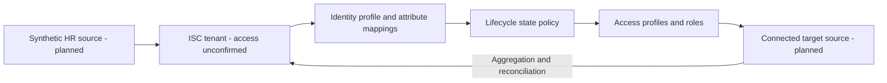

# SailPoint Identity Security Cloud: alternative platform roadmap

**Documentation status: Conceptual. Practical exercises: Planned.** No working ISC tenant, licensed features, API credentials, source configuration, or completed tests have been inspected. This is an alternative to the local IdentityIQ architecture, not an assertion that both products run together.

## Architecture and vocabulary

IdentityIQ is the self-hosted platform used in the reported lab. ISC is a cloud service with its own configuration model and APIs. IIQ BeanShell, `SailPointContext`, Workflow XML, and `ProvisioningPlan` examples in this repository must not be copied into ISC. SailPoint's current SaaS documentation also uses Identity Services/Human Fabric terminology; confirm the tenant's product and subscription before following a page.

Sources expose accounts and entitlements. An identity profile makes its selected source authoritative and maps account values to identity attributes. Correlation connects other source accounts to identities; profile priority matters when people occur in multiple authoritative sources. These are cloud configuration concepts, not IIQ object exports. [SailPoint identity profiles](https://documentation.sailpoint.com/saas/help/setup/identity_profiles.html)

An access profile groups entitlements from one source; a role can combine access profiles across sources. Requestability, ownership, approvals, and licensing must be checked separately from merely creating a bundle. [SailPoint access model](https://documentation.sailpoint.com/saas/help/access/index.html)

Transforms calculate attribute values. Lifecycle states express employment status and can drive configured account and access changes; preview mappings before applying changes because processing can initiate provisioning. [Lifecycle states](https://documentation.sailpoint.com/saas/help/provisioning/lifecycle.html), [identity processing](https://documentation.sailpoint.com/saas/help/setup/identity_processing.html)

## Practical exercise sequence

All rows are **Planned**, with execution gated by an authorized nonproduction tenant, appropriate subscription, source access, and a documented rollback. Capture actual UI/API versions at execution time.

| Exercise | Northstar requirement and implementation task | Acceptance evidence |
|---|---|---|
| 1. Authoritative source | Load a small synthetic HR feed; inspect schema before aggregation | Aggregation result, sanitized account sample, exception count |
| 2. Identity profile | Map stable employee ID, name, department, manager, dates | Identity attribute preview agrees with HR; required fields populated |
| 3. Correlation | Connect a second source by unique employee ID | One identity with expected accounts; zero-match and duplicate-match cases documented |
| 4. Transforms | Normalize department and calculate a pre-hire/active attribute | Preview includes null, malformed, future-date, and boundary-date cases |
| 5. Access profile | Bundle a harmless test entitlement from one source | Owner and entitlement membership recorded; provisioning result verified on target |
| 6. Role | Represent a fictional job function across profiles | Membership rule matches intended synthetic users; exceptions reviewed |
| 7. Lifecycle states | Model pre-hire, active, leave, and terminated | Each state transition's expected grants/removals and actual target state captured |
| 8. Access request | Require manager/application-owner approval where supported | Approval, denial, expiry, and fulfillment evidence remain distinct |
| 9. Certification | Review one harmless entitlement | Reviewer decision, remediation result, and reaggregation demonstrate closure |
| 10. API read | Use a scoped credential to inspect a synthetic source/identity | Sanitized request metadata, HTTP status, pagination and error handling |
| 11. Event automation | Add a supported event-triggered workflow | Test event, condition match, action result, duplicate-event behavior |

Start API work from the official [SailPoint API documentation](https://developer.sailpoint.com/docs/api/); select a currently supported endpoint/version and its required scopes. API examples must use environment variables and placeholder tenant names. Do not assume a beta endpoint has the same support guarantees as a stable one.

## Governance and advanced study

After the first source-to-target test, study search, access certifications, governance policies, segregation of duties, access modeling, event triggers, workflows, and audit reports. Create a separate capability record with subscription requirements and evidence before promoting any feature to implemented.

Non-human identity governance and AI-assisted recommendations are **Conceptual research topics** here. Verify the relevant offering, identity types, licensed capabilities, and documented limits before designing a lab; do not infer them from core workforce governance features. Recommendations require accountable human review and target-side verification.

## Test record and limitations

**Actual results:** no ISC tenant tests performed. Current materials describe design and planned acceptance criteria only. No cloud source, transform, role, certification, or workflow has been deployed by this repository work.

**Next improvement:** confirm authorized tenant access, record available features without secrets, then execute exercises 1–3 before access automation. Track environment restrictions in the [central status tracker](../docs/implementation-status.md).
